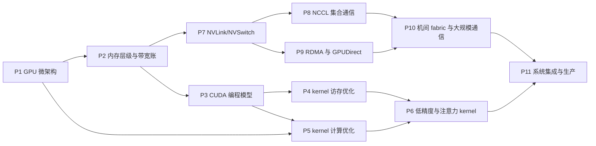

# gpu 维度：目录、依赖图与进度表

gpu 维度讲 GPU 硅片与通信全栈——models 回答「模型是什么」（前向的数学），training 回答「参数怎么来」（反向、优化、并行与配方），inference 回答「模型如何以低延迟、低成本、高吞吐服务请求」（serving 运行时系统），gpu 回答「**硅片与通信基底如何把算子跑快、把数据搬动**」：芯片组织与世代、SM 内部、Tensor Core 与 MMA、指令流水线与延迟隐藏、内存层级与带宽账、CUDA 编程模型、kernel 访存优化、kernel 计算优化与并行原语、低精度与注意力 kernel、节点内 NVLink/NVSwitch、NCCL 集合通信、RDMA 与 GPUDirect、机间 fabric 与大规模通信、系统集成与生产，共 11 个 Part / 41 章。写法与 models / training / inference 同规：公式级推导不跳步、逐公式附符号表、与官方实现代码对照；数值事实（带宽 / 延迟 / 容量 / MMA 吞吐 / 拓扑规格 / config 字段）全部带出处并标注证据等级 [A]/[B]/[C]/[W]（定义见 [STYLE_GUIDE.md](../STYLE_GUIDE.md)；gpu 对硬件官方规格与无 paper 官方 repo 锚点的口径细化见 spec §4.1——[C]「官方规格披露·一手权威」是硬件事实的最高证据档，闭源未披露细节只讲已披露信息、禁推测当事实）；教材笔法（R2）自始适用（spec §4.6，无 retrofit 轮）。模型侧数学形式归 `models/`，训练侧并行算法与通信账归 `training/`，serving 算子算法与策略级、KV cache 系统管理、调度与引擎编排归 `inference/`，平台编排归 `cluster/`——gpu 讲**指令级 kernel 实现、硬件机制、transport 级通信实现**，交叉处只做纯文字指引 + recap 一句、不重复展开（规则见 spec §2/§4.2）。**gpu↔cluster 新 seam（2026-11-24 用户裁定）**：硬件机制与通信全栈（节点内 NVLink → NCCL → RDMA → 机间 fabric → 大规模通信工程）归 gpu；平台编排（K8S GPU 调度 / device plugin / 容器运行时 / Agent Sandbox 隔离 / 多租户编排 / 集群作业调度）归 cluster（cluster 维度重定义为 K8S/容器/Agent Sandbox）。MIG/vGPU/SR-IOV 的硬件分区机制归 gpu 11.1，K8S device plugin 与调度策略归 cluster。原 cluster 通信 scope（EP a2a 通信实现、Ring Attention 通信细节、集合通信与网络拓扑、NVLink/IB 层级）全部重判到 gpu，P10 承接。边缘 / CPU 推理与非 NVIDIA GPU（AMD/Ascend）微架构不覆盖（spec §2；Ascend 规格事实若 serving 账需要沿 inference [C] keynote 口径引用，不做微架构展开）。

本文件是全维度唯一进度事实源：逐章状态见下方进度表，各波 evaluator 审查结论追加在文末审查记录区。章节大纲与波次划分的唯一设计事实源是 [spec](../docs/superpowers/specs/2026-11-24-gpu-dimension-design.md)；文献索引与术语表见 [references.md](references.md)。

## 前置知识

- **models 维度 Part 1-2**：参数/计算/内存的账（1.2）、Transformer 各组件推导（2.1-2.8，尤其 2.4 KV cache 容量式与算术强度 / roofline 入口）——或同等知识；跨章引用一律纯文字（如「models 2.4 §6」）
- **models 维度 4.1**：FlashAttention 前向数学与 online softmax 正确性、IO 复杂度定理、MLA 低秩推导与吸收形——本维度只 recap 一句 + 纯文字指引，不重复推导
- **training 维度 Part 4-5**：DDP ring all-reduce 消息量与 α-β 模型（4.1）、TP/SP-CP/PP/EP 并行账（5.1 TP / 5.2 SP-CP / 5.3 PP / 5.4 EP / 5.5 组合策略）——或同等知识；本维度 recap 时符号翻译（training d → gpu n）
- **inference 维度 Part 1/3/8**：serving 性能账与 datasheet 参数表（1.2/1.3）、推理算子算法与策略级（P3）、分布式并行与 KV 传输语义（P8）——或同等知识；gpu 只接指令级 / transport 级增量
- 线性代数与概率论：同 models 维度
- C/C++/Python：能读 kernel 与通信栈源码——代码走读锚点是 CUTLASS、FlashAttention、NCCL、DeepEP、Marlin、DeepGEMM 等 repo 的具体文件与函数；CUDA 编程模型与 kernel 章需能读 CUDA C++

章节自包含：每个公式附符号表；跨章前置概念给纯文字指引，不重复展开。recap models / training / inference 公式时一律把兄弟维度符号翻译为本维度约定（spec §4.3 翻译硬规则：training d（DP 度）→ n（rank 数）、models b（每元素字节）→ bytes、models 4.1 FA d（head 维）→ d_head、IO 定理 M（SRAM 元素计）→ M_SRAM 章首声明、α/β 章首声明通信语义非 inference 接受率），附一句口径注。已交付公式只 recap 忠实性核对，不重推导（spec §4.2 / §6.3 强制清单）。

锚定纪律：官方实现引用一律到 repo + 文件 + 函数级并记录核实日期；硬件事实以 NVIDIA 官方规格（whitepaper / datasheet / CUDA Programming Guide / PTX ISA / NCCL docs / GPUDirect docs / IBTA 规范）为最高证据档（[C] 官方规格披露·一手权威，spec §4.1）；库内部类名/路径随版本漂移时，正文标注核实时的版本或 tag（如 DeepEP 机制锚 tag v1.2.1、接口锚当前 main）。

## 目录

### Part 1 · GPU 微架构拆解（`01-gpu-microarchitecture/`，4 章，W1）

- 1.1 芯片组织与世代（`01-chip-organization-and-generations.md`）
- 1.2 SM 内部拆解（`02-sm-internals.md`）【重】
- 1.3 Tensor Core 与 MMA 微架构（`03-tensor-core-mma.md`）
- 1.4 指令流水线与延迟隐藏（`04-instruction-pipeline-latency-hiding.md`）

### Part 2 · 内存层级与带宽账（`02-memory-hierarchy/`，4 章，W1）

- 2.1 HBM 与显存子系统（`01-hbm-and-memory-subsystem.md`）
- 2.2 缓存层级（`02-cache-hierarchy.md`）
- 2.3 片上存储与 register（`03-onchip-storage-registers.md`）
- 2.4 内存带宽账与 roofline（`04-bandwidth-accounting-roofline.md`）【重】

### Part 3 · CUDA 编程模型（`03-cuda-programming-model/`，4 章，W2）

- 3.1 线程层级与 SIMT（`01-thread-hierarchy-simt.md`）
- 3.2 内存模型与地址空间（`02-memory-model-address-spaces.md`）
- 3.3 Stream / Event / Graph 异步（`03-stream-event-graph.md`）
- 3.4 Occupancy 与资源约束（`04-occupancy-resource-constraints.md`）

### Part 4 · Kernel 访存优化（`04-kernel-memory-optimization/`，4 章，W2）· kernel 深水区①

- 4.1 访存合并与向量化（`01-coalescing-vectorization.md`）
- 4.2 Shared memory 与 bank conflict（`02-shared-memory-bank-conflicts.md`）
- 4.3 Tiling 与数据复用（`03-tiling-data-reuse.md`）【重】
- 4.4 异步拷贝与流水线（`04-async-copy-pipelining.md`）

### Part 5 · Kernel 计算优化与并行原语（`05-kernel-compute-primitives/`，4 章，W3）· kernel 深水区②

- 5.1 Reduction 与 Scan（`01-reduction-scan.md`）【重】
- 5.2 GEMM kernel 设计与走读（`02-gemm-kernel-design.md`）【重】
- 5.3 Softmax / LayerNorm / RMSNorm kernel（`03-softmax-layernorm-rmsnorm.md`）
- 5.4 算子融合原理（`04-operator-fusion.md`）

### Part 6 · 低精度与注意力 kernel（`06-low-precision-attention-kernels/`，4 章，W3）· kernel 深水区③

- 6.1 低精度格式与 Tensor Core（`01-low-precision-formats.md`）
- 6.2 量化 kernel（`02-quantization-kernels.md`）
- 6.3 FlashAttention kernel 走读（`03-flashattention-kernel.md`）【重】
- 6.4 注意力变体 kernel（`04-attention-variant-kernels.md`）

### Part 7 · 节点内互连 NVLink/NVSwitch（`07-nvlink-nvswitch/`，3 章，W4）

- 7.1 NVLink / NVSwitch 架构（`01-nvlink-nvswitch-architecture.md`）
- 7.2 节点内拓扑与带宽账（`02-node-topology-bandwidth.md`）
- 7.3 GPUDirect P2P（`03-gpudirect-p2p.md`）

### Part 8 · NCCL 集合通信（`08-nccl-collectives/`，4 章，W4）

- 8.1 集合原语与消息量账（`01-collective-primitives.md`）
- 8.2 Ring 算法（`02-ring-algorithms.md`）【重】
- 8.3 Tree / 双二叉树算法（`03-tree-algorithms.md`）
- 8.4 NCCL 实现走读（`04-nccl-implementation.md`）

### Part 9 · RDMA 与 GPUDirect（`09-rdma-gpudirect/`，3 章，W5）

- 9.1 RDMA 原理（`01-rdma-fundamentals.md`）
- 9.2 GPUDirect RDMA（`02-gpudirect-rdma.md`）【重】
- 9.3 拥塞控制与传输可靠性（`03-congestion-reliability.md`）

### Part 10 · 机间 fabric 与大规模通信（`10-fabric-and-scale-communication/`，4 章，W5）· 承接原 cluster 通信 scope

- 10.1 机间 fabric 架构与拓扑（`01-fabric-architecture-topology.md`）
- 10.2 拓扑感知集合与网内聚合（`02-topology-aware-collectives-sharp.md`）
- 10.3 EP all-to-all 通信实现（`03-ep-alltoall-implementation.md`）
- 10.4 点对点与序列并行通信（`04-point-to-point-sequence-parallel.md`）

### Part 11 · 系统集成与生产（`11-system-integration/`，3 章，W6）

- 11.1 GPU 服务器硬件形态（`01-server-forms-mig.md`）
- 11.2 Profiling 与调优方法论（`02-profiling-tuning.md`）
- 11.3 故障与可靠性（`03-faults-reliability.md`）

## Part 依赖图

机制线 P1→P2→P3→P4/P5→P6（硬件→编程模型→kernel 深水区），通信线 P2→P7→P8/P9→P10（带宽账→互连→集合/RDMA→fabric），P11 合流生产。14 边。波次序与依赖一致（W1=P1+P2 / W2=P3+P4 / W3=P5+P6 / W4=P7+P8 / W5=P9+P10 / W6=P11）；波内依赖 5 边（P1→P2、P3→P4、P5→P6、P7→P8、P9→P10）由 writer brief 大纲固定 + 并行写作（inference W1 先例）。章级 recap 接口与前瞻指针（典型枚举，全量以大纲回链为准）：recap 接口 6.1←1.3（MMA 指令几何）、6.3←4.3（tiling 强度）、10.2←8.4（NCCL 机制）——定义章早于使用章；波内前瞻 10.3←9.2（GDR）；跨波前瞻 1.2→3.4、1.4→11.2、2.2→7.x、2.3→4.2、3.1→5.1、4.3→5.2、4.4→5.2、7.1→10.2、7.3→9.2；波内章级互引（9.2↔10.3、5.4↔6.3 等）由固定大纲覆盖。

## 进度表

状态取值与流转：未开始 → 已写（write pass 完成）→ 审查中（evaluator 对抗审查与修复进行中）→ 已关闭（S1/S2 findings 全部修复、复审通过）。更新规则：每章状态变化即改对应行，随同该波 commit 提交（spec §6.4 / §6.5）；其他文件不重复维护进度。

### Part 1 · GPU 微架构拆解（W1）

| 章节 | 文件 | 状态 |
| --- | --- | --- |
| 1.1 芯片组织与世代 | 01-chip-organization-and-generations.md | 已关闭 |
| 1.2 SM 内部拆解 | 02-sm-internals.md | 已关闭 |
| 1.3 Tensor Core 与 MMA 微架构 | 03-tensor-core-mma.md | 已关闭 |
| 1.4 指令流水线与延迟隐藏 | 04-instruction-pipeline-latency-hiding.md | 已关闭 |

### Part 2 · 内存层级与带宽账（W1）

| 章节 | 文件 | 状态 |
| --- | --- | --- |
| 2.1 HBM 与显存子系统 | 01-hbm-and-memory-subsystem.md | 已关闭 |
| 2.2 缓存层级 | 02-cache-hierarchy.md | 已关闭 |
| 2.3 片上存储与 register | 03-onchip-storage-registers.md | 已关闭 |
| 2.4 内存带宽账与 roofline | 04-bandwidth-accounting-roofline.md | 已关闭 |

### Part 3 · CUDA 编程模型（W2）

| 章节 | 文件 | 状态 |
| --- | --- | --- |
| 3.1 线程层级与 SIMT | 01-thread-hierarchy-simt.md | 已关闭 |
| 3.2 内存模型与地址空间 | 02-memory-model-address-spaces.md | 已关闭 |
| 3.3 Stream / Event / Graph 异步 | 03-stream-event-graph.md | 已关闭 |
| 3.4 Occupancy 与资源约束 | 04-occupancy-resource-constraints.md | 已关闭 |

### Part 4 · Kernel 访存优化（W2）

| 章节 | 文件 | 状态 |
| --- | --- | --- |
| 4.1 访存合并与向量化 | 01-coalescing-vectorization.md | 已关闭 |
| 4.2 Shared memory 与 bank conflict | 02-shared-memory-bank-conflicts.md | 已关闭 |
| 4.3 Tiling 与数据复用 | 03-tiling-data-reuse.md | 已关闭 |
| 4.4 异步拷贝与流水线 | 04-async-copy-pipelining.md | 已关闭 |

### Part 5 · Kernel 计算优化与并行原语（W3）

| 章节 | 文件 | 状态 |
| --- | --- | --- |
| 5.1 Reduction 与 Scan | 01-reduction-scan.md | 已关闭 |
| 5.2 GEMM kernel 设计与走读 | 02-gemm-kernel-design.md | 已关闭 |
| 5.3 Softmax / LayerNorm / RMSNorm kernel | 03-softmax-layernorm-rmsnorm.md | 已关闭 |
| 5.4 算子融合原理 | 04-operator-fusion.md | 已关闭 |

### Part 6 · 低精度与注意力 kernel（W3）

| 章节 | 文件 | 状态 |
| --- | --- | --- |
| 6.1 低精度格式与 Tensor Core | 01-low-precision-formats.md | 已关闭 |
| 6.2 量化 kernel | 02-quantization-kernels.md | 已关闭 |
| 6.3 FlashAttention kernel 走读 | 03-flashattention-kernel.md | 已关闭 |
| 6.4 注意力变体 kernel | 04-attention-variant-kernels.md | 已关闭 |

### Part 7 · 节点内互连 NVLink/NVSwitch（W4）

| 章节 | 文件 | 状态 |
| --- | --- | --- |
| 7.1 NVLink / NVSwitch 架构 | 01-nvlink-nvswitch-architecture.md | 已关闭 |
| 7.2 节点内拓扑与带宽账 | 02-node-topology-bandwidth.md | 已关闭 |
| 7.3 GPUDirect P2P | 03-gpudirect-p2p.md | 已关闭 |

### Part 8 · NCCL 集合通信（W4）

| 章节 | 文件 | 状态 |
| --- | --- | --- |
| 8.1 集合原语与消息量账 | 01-collective-primitives.md | 已关闭 |
| 8.2 Ring 算法 | 02-ring-algorithms.md | 已关闭 |
| 8.3 Tree / 双二叉树算法 | 03-tree-algorithms.md | 已关闭 |
| 8.4 NCCL 实现走读 | 04-nccl-implementation.md | 已关闭 |

### Part 9 · RDMA 与 GPUDirect（W5）

| 章节 | 文件 | 状态 |
| --- | --- | --- |
| 9.1 RDMA 原理 | 01-rdma-fundamentals.md | 已关闭 |
| 9.2 GPUDirect RDMA | 02-gpudirect-rdma.md | 已关闭 |
| 9.3 拥塞控制与传输可靠性 | 03-congestion-reliability.md | 已关闭 |

### Part 10 · 机间 fabric 与大规模通信（W5）

| 章节 | 文件 | 状态 |
| --- | --- | --- |
| 10.1 机间 fabric 架构与拓扑 | 01-fabric-architecture-topology.md | 已关闭 |
| 10.2 拓扑感知集合与网内聚合 | 02-topology-aware-collectives-sharp.md | 已关闭 |
| 10.3 EP all-to-all 通信实现 | 03-ep-alltoall-implementation.md | 已关闭 |
| 10.4 点对点与序列并行通信 | 04-point-to-point-sequence-parallel.md | 已关闭 |

### Part 11 · 系统集成与生产（W6）

| 章节 | 文件 | 状态 |
| --- | --- | --- |
| 11.1 GPU 服务器硬件形态 | 01-server-forms-mig.md | 已关闭 |
| 11.2 Profiling 与调优方法论 | 02-profiling-tuning.md | 已关闭 |
| 11.3 故障与可靠性 | 03-faults-reliability.md | 已关闭 |

## 审查记录

各波 evaluator 对抗审查的结论追加在此处（流程、severity 分级与 verification log 要求见 spec §6.3）。此处只记汇总；完整 findings 表与 verification log 存各波审查档案（`docs/reviews/`）。

| 波次 | 日期 | 覆盖章节 | 审查轮次 | S1 | S2 | S3 | 未关闭项 | 结论 |
| --- | --- | --- | --- | --- | --- | --- | --- | --- |
| W0 | 2026-11-24 | spec 本身（11 Part/41 章大纲）+ 脚手架 | 四路独立对抗审查 ×1（A P1-P4/B P5-P6/C P7-P11/D 设计）+ builder-check ×1 + 逐任务 fresh reviewer ×6（T1-T6） | 0（raw 1→0） | 17（raw 24 去重，全修） | 21（raw 24 去重，全修） | 无 | **放行（W1 开工放行）**。spec 四路档案 docs/reviews/gpu-spec-review-{a,b,c,d}.md；脚手架全绿：references 11 Part 59 条 + 术语表；README 41 章进度表 + 14 边依赖图 + 93 行指针盘点（86 章命中，sweep 内容过滤器纠正 raw 116→86）；lint gpu 分支 + 127 章回归全过；STYLE_GUIDE 四维度泛化条款零漂移；站点 DIMENSIONS gpu {0,0,50} + 12 字段 UI + 14 边图 + FORTHCOMING.gpu 移除 + cluster/根 README 新 scope；全量 QA 绿（164 页/5089 引用/qa-shots 桌面移动全过，dist 无 /gpu/ live W1）。 |
| W1 | 2026-11-25 | P1+P2 8 章（1.1–1.4 / 2.1–2.4） | task reviewer×4 + fix rounds + T6 P1/P2 深度对抗审查 + T8 图 QUALITY（18/18） | 0 | 0 | 13（P1×6 + P2×7，全修；L 消歧跨 Part 同址两计；同类扩展修：2.3 T1 泄漏 / 2.4 脚注归属 / refs 条目归属） | 无（⟨verify W3/W6⟩ B200 SM 数等为 spec 允许延迟项，不计 finding） | **放行（W1 收官，/gpu/ live）**。重推导 1.2 PASS（active warps 32/16/32/32/0）/ 2.4 PASS（112/112 独立重算），recap 边界 PASS；档案 docs/reviews/gpu-w1-review-{p1,p2}.md + gpu-w1-fig-quality.md（7 条非阻塞 polish 延迟站点 fix 轮，图不动）；refs 被引回写 12 条（forward+reverse 交叉核）+ nvbandwidth README 核实日期 11-25；兄弟 README 3 处边界句 errata（见本节 errata 表）；站点断言 {8,2,50}；QA 全绿：build:content gpu 8 章/2 Part/64 refs + 回归 models 51/training 39/inference 37，build 176 页零 KaTeX，pagefind 135 页/105860 词，check-links 5418 引用零断，qa-shots 36 样页×桌面移动 88 shots 全过（含 gpu index/1.2/2.4），dist 有 /gpu/（live 翻转）。 |
| W2 | 2026-11-25 | P3+P4 8 章（3.1–3.4 / 4.1–4.4） | task reviewer×4 + fix rounds + T6 P3/P4 对抗审查 + T8 图 QUALITY（18/18） | 0 | 3（P3 refs 回写 + P4 bf16 sector / TMA opcount，全修） | 8（P3×2 + P4×6）+ T2-T5 deferred minors，全修 | 无（⟨verify W3/W6⟩ B200 SM 数等为 spec 允许延迟项，不计 finding） | **放行（W2 收官）**。重推导 3.4 occupancy + 4.3 tiling PASS、recap 边界 PASS、coalescing 方向 PASS（distinct 32 / ceil 63）；档案 docs/reviews/gpu-w2-review-{p3,p4}.md + gpu-w2-fig-quality.md；refs 被引回写 11 条（forward+reverse 交叉核 0 缺口）+ glossary 首现 sweep（W1 残留 5 + W2 新词 22）+ 1.4 练习 4b 需求侧注；站点断言 {16,4}；QA 全绿：build:content gpu 16 章/4 Part/68 refs + 回归 models 51/training 39/inference 37，build 186 页零 KaTeX，pagefind 143 页/109232 词，check-links 186 页/5704 引用零断，qa-shots 38 样页×桌面移动 92 shots 全过（含 gpu index/1.2/2.4/3.4/4.3）。 |
| W3 | 2026-11-25 | P5+P6 8 章（5.1–5.4 / 6.1–6.4） | task reviewer×4 + fix rounds + T6 P5/P6 对抗审查 + T8 图 QUALITY（22/22） | 0 | 7（P5×4：5.1 fp32 ridge 口径 / 5.4 符号 S 撞 / 5.1 reduce7 锚误归 / 5.3 禁令词；P6×3：6.4 DSA 比值口径 / 6.4 V4.1 decode bound / 6.1 B200 INT8 峰值，全修） | 14（P5×7 + P6×7）+ T2-T5 deferred minors，全修 | 无（⟨verify W3/W6⟩ B200 SM 数等为 spec 允许延迟项，不计 finding） | **放行（W3 收官）**。重推导 5.1 reduction/Blelloch + 5.2 GEMM tile/利用率 + 6.3 tile 预算/精确 HBM 流量 PASS、recap 边界 PASS、MLA 两代几何 PASS、NVFP4 UE4M3 PASS；档案 docs/reviews/gpu-w3-review-{p5,p6}.md + gpu-w3-fig-quality.md（22/22，e423b50 redraw closure addendum）；refs 被引回写 17 补 + 2 撤 over-claim（24 章 forward+reverse 交叉核 0 缺口）+ glossary 首现语义列 sweep（W2 残留 4 归位 + 同口径 12 + W3 新词 23）+ cluster/DSMEM 指针 retarget 5.2（W2 残留）+ 4.4 (S−1)τ_S 措辞/骨架 smem comment；站点断言 {24,6,50}；QA 全绿：build:content gpu 24 章/6 Part/69 refs + 回归 models 51/training 39/inference 37，build 196 页零 KaTeX，pagefind 151 页/112216 词，check-links 196 页/5965 引用零断，qa-shots 40 样页×桌面移动 80 shots 全过（含 gpu index/1.2/2.4/3.4/4.3/5.2/6.3）。 |
| W4 | 2026-11-25 | P7+P8 7 章（7.1–7.3 / 8.1–8.4） | task reviewer×4 + fix rounds + T6 P7/P8 对抗审查 + T8 图 QUALITY（20/20） | 0 | 1（7.3 串行端到端带宽误称「谐波均值」，应为半谐波均值/并联电阻式；公式与数值正确，章 9 处 + p07 fig-6 图标签全修） | 12（P7×4：裸 T→T_serial / 13.6 口径降推定 / 370.8 补 18×20.6 来源 / IOMMU-ACS 坑注拆分；P8×8：tree.cc L33/L35、ll__types.h L26×2、version.mk L9-11+L13、nccl_tuner.h L28-35、mirror/shift nranks 奇偶、\div→/n、Δβ 操作数加digit、prose <sm80）+ W3 残留（6.2 物化 75.7→75.8 / 4.4 PipelineTmaUmmaAsync 措辞 / fig-quality 档案换行），全修 | 无（⟨verify W6⟩ B200 SM 数等为 spec 允许延迟项，不计 finding；PCI-SIG/JEDEC 403 数值口径经 NVIDIA 一手闭合） | **放行（W4 收官）**。重推导 8.2 ring 带宽最优性下界 + 8.3 ring/tree 交叉 M* + 7.2 P2P 每对上界 + 7.1 域聚合恒等式 PASS（P7 72/72 数值重算）、recap 边界 PASS（training 4.1 归纳不重推）、NCCL 全锚 PASS（~75 锚 + 8.1/8.2/8.3 锚，5 处行号偏移修）；档案 docs/reviews/gpu-w4-review-{p7,p8}.md + gpu-w4-fig-quality.md（20/20，6b14438 redraw closure addendum）；refs 被引回写 7 补（31 章 forward+reverse 交叉核 0 缺口）+ glossary 首现语义 sweep（8 归位 + W4 新词 21）；站点断言 {31,8,50}；QA 全绿：build:content gpu 31 章/8 Part/76 refs + 回归 models 51/training 39/inference 37，build 205 页零 KaTeX，pagefind 158 页/114527 词，check-links 205 页/6181 引用零断，qa-shots 42 样页×桌面移动 100 shots 全过（含 gpu index/1.2/2.4/3.4/4.3/5.2/6.3/7.3/8.2）。 |
| W5 | 2026-11-25 | P9+P10 7 章（9.1–9.3 / 10.1–10.4） | task reviewer + fix rounds（T3/T4/T5）+ T6 P9/P10 对抗审查 + T8 图 QUALITY（18/18） | 0 | 1（9.1 DeepEP QP 池「O(n²)→O(n)」标度结论与锚代码矛盾——num_qps_per_rank=24 是 per-peer QP 数、按目的 expert 索引选 QP，全网 24n(n-1) 仍 O(n²)；23b4fb7 修 + 练习 2(d) 校验锚同步） | 12（P9×5：UD STATE 措辞 / refs 回写 5 key / 过程泄漏「spec 旧查」/ 交叉引格式 §9.1→9.1 §7 / T_serial 未用声明；P10×7：main README L38→L39 / ep.py QP L553-557→L553-558 / LL 容差 ~1%→~2% / 命题 3「均衡 a2a 是排列」→均匀流量 / refs 回写 9 条 / torus 借 n·k / SHARP 树深 log n 口径——S3-6/7 裁定接受（显式借用注/口径注已消歧），余全修）+ T4 review（10.3 v1.2.1 zero-SM 引文 L7→L290「without costing any GPU SMs」/ 10.2 SAT max 1GB−32B→1GiB−32B ×3 / 10.2 §9 models 4.5 重判句）+ W4 残留 3（README W4 行 162→100 shots / 8.2 L44 旋转括注删特定 rank/chunk 对 / 8.4 Mc→$M_c$ ×2）+ T1 minor（research L38→L39 + EOF 换行），全修 | 无（⟨verify W6⟩ B200 SM 数等为 spec 允许延迟项，不计 finding；Al-Fares PDF / IBTA 全文 member-gated / PCI-SIG·JEDEC 403 数值口径经 NVIDIA 一手互证闭合） | **放行（W5 收官）**。重推导 9.2 GDR 带宽 min regime + 9.3 DCQCN 速率收敛 + 10.1 fat-tree 收敛比/规模 + 10.3 a2a incast + 10.4 Ring Attention overlap PASS（P9 47/47 + P10 172/172 独立重算 + König 构造性路由 120 trial + 双缓冲仿真全 regime）、recap 边界 PASS（inference 8.3 / training 5.2·5.4 / models 4.6 不重推）、DeepEP 双锚 PASS（NVSHMEM 全移除 + IBGDA 仅注释 live grep）、代码锚 P9 全命中 / P10 ~60 命中（2 off-by-one 修）；档案 docs/reviews/gpu-w5-review-{p9,p10}.md + gpu-w5-fig-quality.md（18/18，aa84fcf，diffpx=0）；refs 被引回写 18 补 + 3 撤 over-claim（38 章 forward+reverse 交叉核 0 缺口、84 entries 0 竖线）+ glossary 首现语义 sweep（GDR→7.3 / CollNet→8.1 归位 + W5 新词 17）；站点断言 {38,10,50}；QA 全绿：build:content gpu 38 章/10 Part/84 refs + 回归 models 51/training 39/inference 37，build 214 页零 KaTeX，pagefind 165 页/117449 词，check-links 214 页/6448 引用零断，qa-shots 44 样页×桌面移动 104 shots 全过（含 gpu index/1.2/2.4/3.4/4.3/5.2/6.3/7.3/8.2/9.2/10.3）。 |
| W6 | 2026-11-26 | P11 3 章（11.1–11.3） | task reviewer×3 + fix rounds（T3/T5）+ T6 P11 对抗审查 + S2 scoped re-review + T8 图 QUALITY（13/13） | 0 | 2（11.3 NVLink5 计数器版本 v550→应 v560 ×3 处 + refs/research 同源；11.2 §6 点 D provenance 注跨章坐标恒等误述——a593fdf/7f7d0cf 修 + scoped re-review 通过） | 9（S3-1 kernel 数引文 inf3.4§3 / S3-2 1.1 式(2)→式(1) / S3-3 四面板→五面板 ×4——3 项 T5 fix 轮先修；S3-4 符号声明措辞（n/N/B/T 全书保留语义）/ S3-5 refs citedBy 6 条缺 11.2 / S3-6 gb200-nvl72 57.6 Tbps tray-chip 混 / S3-7 练习 4(d) 缺 B200 11.6% / S3-8 §7 ASCII 框右边框 7 行对齐 / S3-9 参考条 TEE-I/O over-claim 撤——T7 全修；附 refs/research 同源 v560 + blackwell-b200-microbench lineage 订正（hopper-microbench 为 Luo et al.）+ research EOF 换行） | 无（B200 SM 数经 [B] 微基准口径 148 销项；JEDEC/PCI-SIG 403、Al-Fares PDF、Cornell CAC 000 为 spec 允许延迟项，不计 finding） | **放行（W6 收官，全书 41 章满）**。重推导 11.1 MIG 切片几何/实例上界/N+N 供电/散热介质/TCO + 11.2 三段账/四因子分解/带宽饱和加速/MFU/busbw + 11.3 remap 容量/thermal 上界/replay 几何/链路降级 PASS（207/207 独立重算）、recap 边界 PASS（2.1 §4/2.4/1.4/3.4/4.1/7.2/9.3/10.2 + inference 3.4/8.5、training 7.3/7.4 不重推）、MIG 几何与 XID 语义对官方一手逐字忠实（L2 跨代不对称、74→149 漂移两高危坑钉住）、新 seam 零展开；档案 docs/reviews/gpu-w6-review-p11.md + gpu-w6-fig-quality.md（13/13，5bfc2d0 redraw closure）；refs 被引回写 7 补 + 1 撤 over-claim（blackwell-b200-microbench -= 1.1，41 章 forward+reverse 交叉核 0 缺口、88 entries 0 竖线）+ glossary 首现语义 sweep（ECC→2.1 / Nsight 拆分 NCU→1.4·nsys→2.4 归位 + W6 新词 26）；站点断言 {41,11,50} 全书满；QA 全绿：build:content gpu 41 章/11 Part/88 refs + 回归 models 51/training 39/inference 37，build 218 页零 KaTeX，pagefind 168 页/119229 词，check-links 218 页/6586 引用零断，qa-shots 46 样页×桌面移动 108 shots 全过（含 gpu index/1.2/2.4/3.4/4.3/5.2/6.3/7.3/8.2/9.2/10.3/11.1/11.2）。W7 全书 sweep 收官锁死 {41,11}。 |
| W7 | 2026-11-26 | 全书 41 章 sweep + 兄弟维指针 errata（models 51 / training 39 / inference 37） | T1 全书审计（fresh whole-book）+ T2/T3/T4 并行执行 + T5 closeout + 全书终审（fresh 独立 reviewer） | 0 | 0 | 6（T1 审计全修：8.1:98 / 10.3:49 排列族→均匀流量双随机 / 9.2:122 D2H+H2D typo / 10.4:199 表头口径 / 1.3:176+230 verify scope 注 / refs deepseekv3 notes stale） | 无（全书 ⟨verify⟩ 历史标记 W7 终 sweep 全销项/标注历史，章文件 0 残留；JEDEC/PCI-SIG 403、Al-Fares PDF、IBTA 全文 member-gated、Cornell CAC 000 为 spec 允许延迟项，数值口径经 NVIDIA/成员官方一手互证闭合） | **放行（W7 收官，全书 41 章 / 11 Part 完成，断言锁死 {41,11}，/gpu/ 全站 live）**。T1 数值脊柱/recap 链/refs 0 缺口/glossary 190/R2 机械面全 PASS（S1=S2=0）；兄弟维 errata 88 条 pointer-only（84 章级 + 4 references，零公式零数值改动，commit 3bf3e26），执行后章级活指针「归 cluster/cluster 维度/gpu/cluster」0 残留、回归 models 51/training 39/inference 37 不变；gpu 残留清（1.1/1.3 verify 回写、排列族、9.2 typo、10.4 表头，commit 1023666）+ 图排列族 gpu-p08/p10（commit 892e4a9）+ 根 README gpu 翻 live；refs 终 sweep：blackwell-b200-microbench citedBy += 1.1（293 pairs forward+reverse 0 缺口/0 unknown）+ deepseekv3 notes stale 修（DualPipe/10.3 间接注）+ glossary 190 首次实质引入终核 + parse-check 11 groups/88 entries；站点断言 {41,11,50} 收官锁死（book complete 注释）；QA 全绿：build:content gpu 41 章/11 Part/88 refs + 回归 models 51/training 39/inference 37，build 218 页零 KaTeX，pagefind 168 页/119251 词，check-links 218 页/6589 引用零断（含兄弟维 errata 新链接），qa-shots 108 shots 全过 + og.png 再生（168 章/39 Part/88.0 万字/33,744 式，manifest totalCjk 880198）。五维度教材 models 51/training 39/inference 37/gpu 41 = 168 章；cluster（第5维 K8S/容器/Sandbox）待后续。 |

**⟨verify⟩ 历史标记终 sweep（W7）**：上表 W1–W5 行「未关闭项」列中的 ⟨verify W3/W6⟩ / ⟨verify W6⟩ 为各波**历史延迟项记录**（spec 允许延迟、不计 finding），非当前未关闭项。W7 终 sweep 确认全数销项/处置：B200 SM 数经 W6 [B] 微基准（arXiv:2512.02189）销项、W7 回写 1.1 正文（blackwell-b200-microbench citedBy += 1.1）；1.3 tcgen05 形状表改显式 scope 注销项（含 1.3:230 CUTLASS 版本锚第二处，审计内容过滤器假阴漏列）；JEDEC/PCI-SIG 403、Al-Fares PDF、IBTA 全文 member-gated、Cornell CAC 000 为 spec 允许延迟项，数值口径经 NVIDIA/成员官方一手互证闭合。**全书 41 章正文 ⟨verify⟩ 标记 0 残留**；上表历史标记保留作审计轨迹。

**跨维度指针 errata 记录**（spec §2 条款授权，仅限指针句的最小修订；errata 编辑不跑 rewrite-gate）：

| 日期 | 位置 | 修订 |
| --- | --- | --- |
| 2026-11-25 | models/README.md L3 边界句 | 「训练算法、serving 系统、GPU kernel、集群通信分别归 training/、inference/、gpu/、cluster/」→「训练算法、serving 系统、GPU kernel 与通信全栈、平台编排（K8S/容器/Sandbox）分别归 training/、inference/、gpu/、cluster/」（spec §2 新 seam：通信全栈归 gpu、平台编排归 cluster；W0 盘点 README 级行，仅限指针句最小修订，其余文本不动） |
| 2026-11-25 | training/README.md L3 边界句 | 「kernel 归 gpu/，网络与拓扑归 cluster/」→「kernel 与通信网络/拓扑归 gpu/，平台编排归 cluster/」（同上新 seam；仅限指针句最小修订） |
| 2026-11-25 | inference/README.md L3 边界句 | 「GPU silicon 实现归 gpu/，跨机通信硬件归 cluster/」→「GPU silicon 与通信全栈（含跨机通信硬件）归 gpu/，平台编排归 cluster/」（同上新 seam；仅限指针句最小修订） |

**W7 兄弟维指针 errata 执行表**（2026-11-26，commit 3bf3e26，88 条 = 84 章级 + 4 references；spec §2 pointer-only，零公式零数值改动，新增数字均为章号指针。执行前重跑 W0 扫描 = 86 章级命中零漂移；2 MFU 保留行不动、3 兄弟 README L3 边界句 W1 已做未重做。盘点行按「位置键」定位，防 T5 入表行号漂移）：

| # | 位置（file:line） | 修订（原句 → 新句） | 目标 gpu 章 | 盘点行（位置键） | 执行波次 |
| --- | --- | --- | --- | --- | --- |
| 1 | models/01-foundations/02-compute-accounting.md:90 | 「elementwise、通信、IO 不计；后两者归 cluster 维度。」→「elementwise、通信、IO 不计；通信账归 gpu 8.1 / 10.1，IO 项按内容分账——访存 IO 归 gpu 2.4、数据加载 IO 归 training 7.1。」 | 通信 8.1/10.1；IO 分账 2.4 / training 7.1 | models 1.2 §5（L90） | W7 |
| 2 | models/01-foundations/02-compute-accounting.md:245 | 「微架构来源与测量方法归 gpu 维度」→「微架构来源与测量方法归 gpu 2.1 / 2.4 / 11.2」 | 2.1/2.4/11.2 | models 1.2 §10（L245） | W7 |
| 3 | models/01-foundations/03-scaling-laws.md:192 | 「集群侧属 cluster 维度」→「通信硬件与 transport 属 gpu 8.1 / 10.3」 | 8.1/10.3 | models 1.3 §6（L192） | W7 |
| 4 | models/02-transformer-anatomy/04-causality-and-kv-cache.md:88 | 「逐卡测量方法归 gpu 维度」→「逐卡测量方法归 gpu 2.4 / 11.2」 | 2.4/11.2 | models 2.4 §3（L88） | W7 |
| 5 | models/02-transformer-anatomy/04-causality-and-kv-cache.md:216 | 「微架构来源与测量方法归 gpu 维度」→「微架构来源与测量方法归 gpu 2.1 / 2.4 / 11.2」 | 2.1/2.4/11.2 | models 2.4 §6（L216） | W7 |
| 6 | models/02-transformer-anatomy/04-causality-and-kv-cache.md:244 | 「微架构来源与测量方法归 gpu 维度」→「微架构来源与测量方法归 gpu 2.1 / 2.4 / 11.2」 | 2.1/2.4/11.2 | models 2.4 §6（L244） | W7 |
| 7 | models/02-transformer-anatomy/08-assembly.md:367 | 「硬件互联归 cluster 维度」→「硬件互联归 gpu（NVLink → 7.1 / 7.2，机间 → 9.1 / 10.1）」 | 7.1/7.2/9.1/10.1 | models 2.8 §4 提点（L367） | W7 |
| 8 | models/04-modern-architectures/01-kv-compression-and-exact-attention.md:296 | 「实测吞吐数字归 gpu 维度的 benchmark 口径」→「实测吞吐数字归 gpu 2.4 / 11.2 的 benchmark 口径」 | 2.4/11.2 | models 4.1 §5.4（L296） | W7 |
| 9 | models/04-modern-architectures/01-kv-compression-and-exact-attention.md:298 | 「指令级 kernel 实现归 gpu 维度」→「指令级 kernel 实现归 gpu 6.3」 | 6.3 | models 4.1 §5.4（L298） | W7 |
| 10 | models/04-modern-architectures/01-kv-compression-and-exact-attention.md:302 | 「指令级 kernel 实现归 gpu 维度」→「指令级 kernel 实现归 gpu 6.3」 | 6.3 | models 4.1 §6（L302） | W7 |
| 11 | models/04-modern-architectures/01-kv-compression-and-exact-attention.md:316 | 「指令级归 gpu」→「指令级归 gpu 6.3」（总结表 FA2/FA3 行） | 6.3 | models 4.1 总结表（L316） | W7 |
| 12 | models/04-modern-architectures/05-moe.md:327 | 「硬件与网络侧（all-to-all 的带宽与拓扑）归 cluster 维度」→「硬件与网络侧（all-to-all 的带宽账归 gpu 8.1 / 10.3、拓扑归 gpu 10.1）」 | 8.1/10.3/10.1 | models 4.5 §7（L327） | W7 |
| 13 | models/04-modern-architectures/05-moe.md:345 | 「拓扑归 cluster 维度」→「拓扑归 gpu 10.1」（总结表 EP 行） | 10.1 | models 4.5 总结表 EP 行（L345） | W7 |
| 14 | models/04-modern-architectures/06-long-context.md:227 | 「通信调度、overlap 策略与拓扑映射的全部细节归 cluster 维度（边界划分见 `[cluster/README.md](../../cluster/README.md)`）」→「通信调度、overlap 策略与拓扑映射的全部细节归 gpu 维度（Ring Attention 调度 / overlap → 10.4，拓扑映射 → 10.2；边界划分见 `[gpu/README.md](../../gpu/README.md)`）」 | 10.4/10.2；活链接 cluster→gpu 随新 seam 改写 | models 4.6 §3（L227） | W7 |
| 15 | models/04-modern-architectures/06-long-context.md:287 | 「通信实现归 cluster 维度」→「通信实现归 gpu 10.4」（总结表 Ring Attention 行） | 10.4 | models 4.6 总结表（L287） | W7 |
| 16 | models/04-modern-architectures/08-frontier-outlook.md:66 | 「kernel 与流水线的处理归 inference 与 cluster 维度」→「kernel 与流水线的处理归 inference（算子策略）与 gpu（kernel 实现）维度」 | 泛指向裁定（gpu 无 MoD 专章，不塞章号） | models 4.8 §2（L66） | W7 |
| 17 | models/05-case-studies/02-deepseek.md:103 | 「工程侧——DualPipe 流水、all-to-all 通信的低精度化、kernel 实现——归 training / cluster / gpu 维度」→「工程侧——DualPipe 流水归 training 5.3，all-to-all 通信的低精度化归 gpu 10.3（低精度格式 → 6.1），kernel 实现归 gpu 6.2 / 6.3」 | 10.3/6.1/6.2/6.3；DualPipe 仍 training 5.3 | models 5.2 §3.5（L103） | W7 |
| 18 | training/01-autograd-and-backprop/01-computation-graph-and-autograd.md:168 | 「其机制归 gpu 维度（kernel 与图捕获）」→「其机制归 gpu 3.3 / 5.4（kernel 与图捕获）」 | 3.3/5.4 | training 1.1 §7（L168） | W7 |
| 19 | training/01-autograd-and-backprop/01-computation-graph-and-autograd.md:187 | 「有效吞吐的量级口径归 gpu 维度」→「有效吞吐的量级口径归 gpu 2.4 / 11.2」 | 2.4/11.2 | training 1.1 练习 2（L187） | W7 |
| 20 | training/01-autograd-and-backprop/02-operator-backward.md:46 | 「（kernel 层归 gpu 维度）」→「（kernel 层归 gpu 5.2）」 | 5.2 | training 1.2 §2（L46） | W7 |
| 21 | training/01-autograd-and-backprop/02-operator-backward.md:218 | 「块调度与 SRAM 驻留的 kernel 级实现归 gpu 维度」→「块调度与 SRAM 驻留的 kernel 级实现归 gpu 6.3」 | 6.3 | training 1.2 §9（L218） | W7 |
| 22 | training/04-data-parallelism/01-dp-and-ddp.md:73 | 「（硬件侧归 cluster 维度）」→「（硬件侧归 gpu：节点内 → 7.2，机间 → 9.1 / 9.2）」 | 7.2/9.1/9.2 | training 4.1 §2.2（L73） | W7 |
| 23 | training/04-data-parallelism/01-dp-and-ddp.md:75 | 「选择逻辑归 cluster 维度」→「选择逻辑归 gpu 8.3 / 8.4 / 10.2」 | 8.3/8.4/10.2 | training 4.1 §2.2（L75） | W7 |
| 24 | training/04-data-parallelism/01-dp-and-ddp.md:130 | 「变体选择归 cluster」→「变体选择归 gpu 8.3 / 8.4 / 10.2」（总结表树形对照行） | 8.3/8.4/10.2 | training 4.1 总结表（L130） | W7 |
| 25 | training/05-model-parallelism/01-tensor-parallelism.md:158 | 「kernel 归 gpu 维度」→「kernel 归 gpu 6.3」 | 6.3 | training 5.1 §5（L158） | W7 |
| 26 | training/05-model-parallelism/02-sequence-and-context-parallelism.md:71 | 「块调度与 SRAM 驻留的 kernel 细节归 gpu 维度」→「块调度与 SRAM 驻留的 kernel 细节归 gpu 6.3（通信调度 → 10.4）」 | 6.3（通信调度 10.4） | training 5.2 §3 提点（L71） | W7 |
| 27 | training/05-model-parallelism/04-expert-parallelism.md:71 | 「kernel 层的实现归 gpu 维度」→「kernel 层的实现归 gpu 6.2」 | 6.2 | training 5.4 §3（L71） | W7 |
| 28 | training/05-model-parallelism/04-expert-parallelism.md:79 | 「硬件 / 网络拓扑归 cluster 维度」→「硬件 / 网络拓扑归 gpu 10.1，EPLB 通信影响归 gpu 10.3」（serving 侧「归 inference 7.4」W4 已执行部分保留） | 10.1/10.3 | training 5.4 §4（L79） | W7 |
| 29 | training/05-model-parallelism/04-expert-parallelism.md:93 | 「细节归 gpu/cluster 维度」→「细节归 gpu 10.3（transport 级）」 | 10.3 | training 5.4 §6（L93） | W7 |
| 30 | training/05-model-parallelism/04-expert-parallelism.md:95 | 「kernel 实现归 gpu/cluster 维度，本书不展开」→「kernel 实现归 gpu 10.3（transport 级），本书不展开」 | 10.3 | training 5.4 §6（L95） | W7 |
| 31 | training/05-model-parallelism/04-expert-parallelism.md:134 | 「dropless 归 gpu」→「dropless 归 gpu 6.2」（总结表行） | 6.2 | training 5.4 总结表（L134） | W7 |
| 32 | inference/01-principles-and-accounting/02-prefill-decode-accounting.md:19 | 「微架构来源归 gpu 维度」→「微架构来源归 gpu 2.1 / 2.4」 | 2.1/2.4 | inference 1.2 §1 章脊（L19） | W7 |
| 33 | inference/01-principles-and-accounting/02-prefill-decode-accounting.md:226 | 「RDMA 硬件层归 cluster 维度」→「RDMA 硬件层归 gpu 9.1 / 9.2」 | 9.1/9.2 | inference 1.2 §6（L226） | W7 |
| 34 | inference/01-principles-and-accounting/02-prefill-decode-accounting.md:242 | 「（归 P3 与 gpu 维度）」→「（归 P3 与 gpu 4.3 / 5.2 / 6.3）」 | 4.3/5.2/6.3 | inference 1.2 §7（L242） | W7 |
| 35 | inference/01-principles-and-accounting/03-roofline-and-tradeoffs.md:9 | 「微架构来源与测量方法归 gpu 维度」→「微架构来源与测量方法归 gpu 2.1 / 2.4 / 11.2」 | 2.1/2.4/11.2 | inference 1.3 §1（L9） | W7 |
| 36 | inference/01-principles-and-accounting/03-roofline-and-tradeoffs.md:94 | 「互联硬件与拓扑细节归 cluster 维度」→「互联硬件与拓扑细节归 gpu（NVLink 域 → 7.1，机间 → 10.1；灵衢 / UnifiedBus 非 NVIDIA，沿本章 [C] keynote 口径只引规格事实，不做微架构展开）」 | 7.1/10.1 + 非 NVIDIA 注 | inference 1.3 §3（L94） | W7 |
| 37 | inference/02-kv-cache-systems/04-kv-offload-and-tiering.md:96 | 「（硬件协议层归 cluster 维度）」→「（硬件协议层归 gpu 9.2）」 | 9.2 | inference 2.4 §4（L96） | W7 |
| 38 | inference/02-kv-cache-systems/04-kv-offload-and-tiering.md:121 | 「硬件 / 拓扑 / RDMA 协议细节归 cluster 维度」→「硬件 / 拓扑 / RDMA 协议细节归 gpu 7.2 / 9.1 / 9.2 / 10.1」 | 7.2/9.1/9.2/10.1 | inference 2.4 §5（L121） | W7 |
| 39 | inference/02-kv-cache-systems/04-kv-offload-and-tiering.md:181 | 「（硬件协议细节归 cluster 维度）」→「（CXL 硬件协议细节非本书覆盖范围）」 | 措辞裁定（gpu 无 CXL 专章，不塞章号） | inference 2.4 §10（L181） | W7 |
| 40 | inference/03-inference-operators/01-decode-attention-kernels.md:11 | 「warp 级占用率的精确定义与硬件来源归 gpu 维度」→「warp 级占用率的精确定义与硬件来源归 gpu 1.2 / 3.4」 | 1.2/3.4 | inference 3.1 §1（L11） | W7 |
| 41 | inference/03-inference-operators/01-decode-attention-kernels.md:23 | 「warp 内寄存器分配、tensor core 指令形状、SASS 调度归 gpu 维度」→「warp 内寄存器分配、tensor core 指令形状、SASS 调度归 gpu 1.3 / 2.3 / 6.3」 | 1.3/2.3/6.3 | inference 3.1 §1（L23） | W7 |
| 42 | inference/03-inference-operators/01-decode-attention-kernels.md:125 | 「指令级归 gpu 维度」→「指令级归 gpu 6.3」 | 6.3 | inference 3.1 §3（L125） | W7 |
| 43 | inference/03-inference-operators/01-decode-attention-kernels.md:129 | 「TMA / WGMMA 的指令语义归 gpu」→「TMA / WGMMA 的指令语义归 gpu 1.3 / 4.4」 | 1.3/4.4 | inference 3.1 §3（L129） | W7 |
| 44 | inference/03-inference-operators/01-decode-attention-kernels.md:210 | 「TMA 指令语义归 gpu」→「TMA 指令语义归 gpu 4.4」 | 4.4 | inference 3.1 §5（L210） | W7 |
| 45 | inference/03-inference-operators/01-decode-attention-kernels.md:285 | 「指令级优化（PTX 比较 / 位操作、浮点加法代整数加法等）归 gpu 维度」→「指令级优化（PTX 比较 / 位操作、浮点加法代整数加法等）归 gpu 6.4」 | 6.4 | inference 3.1 §7（L285） | W7 |
| 46 | inference/03-inference-operators/01-decode-attention-kernels.md:350 | 「warp / tensor core / SASS 指令级归 gpu 维度」→「warp / tensor core / SASS 指令级归 gpu 6.3 / 6.4」（参考行） | 6.3/6.4 | inference 3.1 参考（L350） | W7 |
| 47 | inference/03-inference-operators/02-weight-quantization.md:311 | 「指令级归 gpu 维度」→「指令级归 gpu 6.2」 | 6.2 | inference 3.2 §7（L311） | W7 |
| 48 | inference/03-inference-operators/03-quantized-gemm-and-moe-kernels.md:7 | 「warp / tensor core / SASS 指令级实现归 gpu 维度，RDMA / NVLink 硬件与拓扑归 cluster 维度」→「warp / tensor core / SASS 指令级实现归 gpu 5.2 / 6.2，RDMA / NVLink 硬件与拓扑归 gpu 7.1 / 9.1 / 10.1」（混合句） | 收窄 5.2/6.2；重判 7.1/9.1/10.1 | inference 3.3 §1（L7） | W7 |
| 49 | inference/03-inference-operators/03-quantized-gemm-and-moe-kernels.md:43 | 同行 3 处：「指令级归 gpu 维度」→「指令级归 gpu 6.2」；「细节归 gpu 维度」（多 warp 括注）→「细节归 gpu 6.2」；「指令级实现归 gpu 维度」→「指令级实现归 gpu 6.2」 | 6.2 ×3 | inference 3.3 §2（L43） | W7 |
| 50 | inference/03-inference-operators/03-quantized-gemm-and-moe-kernels.md:53 | 「指令细节归 gpu 维度」（TMA 括注）→「指令细节归 gpu 4.4」 | 4.4 | inference 3.3 §3（L53） | W7 |
| 51 | inference/03-inference-operators/03-quantized-gemm-and-moe-kernels.md:55 | 「warp specialization / TMA / SASS 级优化归 gpu 维度」→「warp specialization / TMA / SASS 级优化归 gpu 4.4 / 5.2」 | 4.4/5.2 | inference 3.3 §3（L55） | W7 |
| 52 | inference/03-inference-operators/03-quantized-gemm-and-moe-kernels.md:95 | 「指令细节归 gpu 维度」（tile 粒度推论括注）→「指令细节归 gpu 4.3 / 6.2」 | 4.3/6.2 | inference 3.3 §4（L95） | W7 |
| 53 | inference/03-inference-operators/03-quantized-gemm-and-moe-kernels.md:146 | 「硬件测量归 cluster 维度」→「硬件测量归 gpu 9.1 / 11.2」 | 9.1/11.2 | inference 3.3 §6（L146） | W7 |
| 54 | inference/03-inference-operators/03-quantized-gemm-and-moe-kernels.md:150 | 「硬件归 cluster 维度」（QP 括注）→「硬件归 gpu 9.1」 | 9.1 | inference 3.3 §6（L150） | W7 |
| 55 | inference/03-inference-operators/03-quantized-gemm-and-moe-kernels.md:181 | 「指令级实现归 gpu 维度，通信硬件归 cluster 维度」→「指令级实现归 gpu 5.2 / 6.2，通信硬件归 gpu 7.1 / 8.4 / 9.1 / 10.1」（混合句） | 收窄 5.2/6.2；重判 7.1/8.4/9.1/10.1 | inference 3.3 §8（L181） | W7 |
| 56 | inference/03-inference-operators/04-fusion-and-graph-capture.md:7 | 「warp / tensor core / SASS 指令级、Triton codegen 内部归 gpu 维度」→「warp / tensor core / SASS 指令级、Triton codegen 内部归 gpu 5.4 / 6.3」 | 5.4/6.3 | inference 3.4 §1（L7） | W7 |
| 57 | inference/03-inference-operators/04-fusion-and-graph-capture.md:9 | 「测量与微架构来源归 gpu 维度」→「测量与微架构来源归 gpu 3.3 / 11.2」 | 3.3/11.2 | inference 3.4 §1 章脊（L9） | W7 |
| 58 | inference/03-inference-operators/04-fusion-and-graph-capture.md:81 | 「codegen 内部归 gpu 维度」→「codegen 内部归 gpu 5.4」 | 5.4 | inference 3.4 §4（L81） | W7 |
| 59 | inference/03-inference-operators/04-fusion-and-graph-capture.md:99 | 「Inductor / Triton 内部归 gpu 维度」→「Inductor / Triton 内部归 gpu 5.4」 | 5.4 | inference 3.4 §4（L99） | W7 |
| 60 | inference/03-inference-operators/04-fusion-and-graph-capture.md:103 | 「tile 到 thread / warp（线程束）的映射与指令选择归 gpu 维度」→「tile 到 thread / warp（线程束）的映射与指令选择归 gpu 4.3 / 5.4」 | 4.3/5.4 | inference 3.4 §5（L103） | W7 |
| 61 | inference/04-scheduling-and-batching/03-chunked-prefill.md:145 | 「GEMM tile 效率的量化归 3.3 / gpu 维度」→「GEMM tile 效率的量化归 3.3 / gpu 4.3 / 5.2」 | 4.3/5.2 | inference 4.3 §3（L145） | W7 |
| 62 | inference/05-vllm/03-vllm-distributed.md:125 | 「DeepEP 模式与硬件层归 cluster 维度」→「DeepEP 模式与硬件层归 gpu 10.3」 | 10.3 | inference 5.3 §4（L125） | W7 |
| 63 | inference/05-vllm/03-vllm-distributed.md:405 | 「silicon 与通信硬件层归 gpu / cluster 维度」→「silicon 归 gpu P1–P6、通信硬件层归 gpu P7–P10（cluster 仅平台编排）」（混合句，参考行） | silicon P1–P6；通信 P7–P10 | inference 5.3 参考（L405） | W7 |
| 64 | inference/06-sglang/03-sglang-distributed-pd.md:67 | 「RDMA / NVLink 硬件层归 cluster 维度」→「RDMA / NVLink 硬件层归 gpu 7.1 / 9.1」 | 7.1/9.1 | inference 6.3 §2（L67） | W7 |
| 65 | inference/07-deepinfer-and-deepseek/03-deepseek-kernel-stack.md:28 | 「warp / tensor core / SASS 指令级实现归 gpu 维度，RDMA / NVLink 硬件层归 cluster 维度」→「warp / tensor core / SASS 指令级实现归 gpu 6.3 / 6.4，RDMA / NVLink 硬件层归 gpu 7.1 / 9.1」（混合句） | 收窄 6.3/6.4；重判 7.1/9.1 | inference 7.3 §1（L28） | W7 |
| 66 | inference/07-deepinfer-and-deepseek/03-deepseek-kernel-stack.md:48 | 「后者归 gpu」→「后者归 gpu 5.2 / 6.3 / 6.4」 | 5.2/6.3/6.4 | inference 7.3 §2（L48） | W7 |
| 67 | inference/07-deepinfer-and-deepseek/03-deepseek-kernel-stack.md:69 | 「（硬件参数表归 1.3，微架构归 gpu）」→「（硬件参数表归 1.3，NVIDIA 微架构归 gpu 1.1 / 2.1；Ascend 微架构 gpu 不覆盖，沿 inference 1.3 [C] keynote 口径只引规格事实）」 | 1.1/2.1 + Ascend 口径注 | inference 7.3 §3（L69） | W7 |
| 68 | inference/07-deepinfer-and-deepseek/03-deepseek-kernel-stack.md:110 | 「warp specialization / TMA / SASS 级优化归 gpu 维度」→「warp specialization / TMA / SASS 级优化归 gpu 4.4 / 6.3」 | 4.4/6.3 | inference 7.3 §5（L110） | W7 |
| 69 | inference/07-deepinfer-and-deepseek/03-deepseek-kernel-stack.md:120 | 「硬件层归 cluster 维度」→「硬件层归 gpu 8.4 / 10.3」（requirements 版本号逐字未动） | 8.4/10.3 | inference 7.3 §6（L120） | W7 |
| 70 | inference/07-deepinfer-and-deepseek/03-deepseek-kernel-stack.md:136 | 「silicon 归 gpu」→「silicon 归 gpu 6.4」 | 6.4 | inference 7.3 §8（L136） | W7 |
| 71 | inference/07-deepinfer-and-deepseek/04-deepseek-large-scale-ep.md:22 | 「RDMA / NVLink 硬件与网络拓扑归 cluster 维度」→「RDMA / NVLink 硬件与网络拓扑归 gpu 7.1 / 9.1 / 10.1」 | 7.1/9.1/10.1 | inference 7.4 §1（L22） | W7 |
| 72 | inference/07-deepinfer-and-deepseek/04-deepseek-large-scale-ep.md:74 | 「硬件/网络拓扑归 cluster；指针句收窄留 W4 closeout errata 执行（截至本章核实，training 5.4 §4 / models 4.5 §7 原文尚未改）」→「网络拓扑归 gpu 10.1、EPLB 通信影响归 gpu 10.3；serving 侧指针句收窄已于 inference W4 closeout errata 执行（历史注：「原文尚未改」为 W4 写作时点记录，training 5.4 §4 / models 4.5 §7 现文已含「归 inference 7.4」；gpu 部分于 W7 收窄到章号）」 | 10.1/10.3 + 历史注 | inference 7.4 §3（L74） | W7 |
| 73 | inference/07-deepinfer-and-deepseek/04-deepseek-large-scale-ep.md:133 | 「语义归 cluster」→「语义归 gpu 9.1」 | 9.1 | inference 7.4 §8（L133） | W7 |
| 74 | inference/07-deepinfer-and-deepseek/04-deepseek-large-scale-ep.md:135 | 「RDMA 硬件层归 cluster 维度」→「RDMA 硬件层归 gpu 9.1 / 9.2」 | 9.1/9.2 | inference 7.4 §8（L135） | W7 |
| 75 | inference/08-distributed-and-pd/01-serving-parallelism.md:23 | 「RDMA / NVLink 硬件、NCCL 实现、交换机拓扑归 cluster 维度」→「RDMA / NVLink 硬件、NCCL 实现、交换机拓扑归 gpu 7.1 / 7.2 / 8.4 / 9.1 / 10.1」 | 7.1/7.2/8.4/9.1/10.1 | inference 8.1 §1（L23） | W7 |
| 76 | inference/08-distributed-and-pd/01-serving-parallelism.md:62 | 「实测依硬件与实现归 cluster 维度」→「实测依硬件与实现归 gpu 7.2 / 8.4 / 11.2」（τ_lat 教学值 15 μs 等数值未动） | 7.2/8.4/11.2 | inference 8.1 §2（L62） | W7 |
| 77 | inference/08-distributed-and-pd/01-serving-parallelism.md:68 | 「硬件测量归 cluster 维度」→「硬件测量归 gpu 7.2 / 9.1」 | 7.2/9.1 | inference 8.1 §2（L68） | W7 |
| 78 | inference/08-distributed-and-pd/01-serving-parallelism.md:118 | 「实测归 cluster」→「实测归 gpu 8.1 / 10.3」 | 8.1/10.3 | inference 8.1 §4（L118） | W7 |
| 79 | inference/08-distributed-and-pd/01-serving-parallelism.md:122 | 「硬件/网络拓扑归 cluster」→「网络拓扑归 gpu 10.1、EPLB 通信影响归 gpu 10.3」（W4 S3-11 serving 侧「归 7.4」保留不动） | 10.1/10.3 | inference 8.1 §4（L122） | W7 |
| 80 | inference/08-distributed-and-pd/01-serving-parallelism.md:229 | 「NVLink / 灵衢 / RDMA 的硬件实现、NCCL 集合通信库的算法选择与拓扑探测、交换机与网络协议，归 cluster 维度」→「NVLink / RDMA 的硬件实现、NCCL 集合通信库的算法选择与拓扑探测、交换机与网络协议，归 gpu 7.1 / 8.4 / 9.1 / 10.1 / 10.2（灵衢非 NVIDIA，沿 inference 1.3 [C] keynote 口径只引规格事实，不做微架构展开）」 | 7.1/8.4/9.1/10.1/10.2 + 灵衢注 | inference 8.1 §7（L229） | W7 |
| 81 | inference/08-distributed-and-pd/03-kv-transfer.md:194 | 「（硬件协议层归 cluster 维度）」→「（硬件协议层归 gpu 9.2）」 | 9.2 | inference 8.3 §5（L194） | W7 |
| 82 | inference/08-distributed-and-pd/03-kv-transfer.md:210 | 「RDMA 协议（RC/UC/QP）、NIC 硬件、PCIe 拓扑、NVLink 域、交换机与 NCCL 实现归 cluster 维度」→「RDMA 协议（RC/UC/QP）与 NIC 硬件归 gpu 9.1、PCIe 拓扑归 gpu 7.2、NVLink 域归 gpu 7.1、交换机归 gpu 10.1、NCCL 实现归 gpu 8.4」（边界声明） | 9.1/7.2/7.1/10.1/8.4 | inference 8.3 §5 边界声明（L210） | W7 |
| 83 | inference/08-distributed-and-pd/03-kv-transfer.md:325 | 「硬件层（RDMA 协议 / NIC / PCIe 拓扑 / NVLink / NCCL）归 cluster 维度」→「硬件层（RDMA 协议 / NIC / PCIe 拓扑 / NVLink / NCCL）归 gpu 7.1 / 7.2 / 8.4 / 9.1 / 10.1」（总结表行） | 7.1/7.2/8.4/9.1/10.1 | inference 8.3 总结表（L325） | W7 |
| 84 | inference/08-distributed-and-pd/05-elasticity-and-fault-tolerance.md:9 | 「RDMA / NVLink 硬件与网络拓扑归 cluster 维度」→「RDMA / NVLink 硬件与网络拓扑归 gpu 7.1 / 9.1 / 10.1」（章脊） | 7.1/9.1/10.1 | inference 8.5 §1 章脊（L9） | W7 |
| 85 | inference/references.md:93（fa2 条） | 「指令级归 gpu」→「指令级归 gpu 6.3」 | 6.3 | inference/references.md fa2 条（L93） | W7 |
| 86 | inference/references.md:94（fa3 条） | 「指令级归 gpu」→「指令级归 gpu 6.3」 | 6.3 | inference/references.md fa3 条（L94） | W7 |
| 87 | inference/references.md:101（marlin 条） | 「指令级 lop3/bfe 归 gpu」→「指令级 lop3/bfe 归 gpu 6.2」 | 6.2 | inference/references.md marlin 条（L101） | W7 |
| 88 | inference/references.md:104（deepep 条） | 「硬件归 cluster」→「硬件归 gpu 10.3」 | 10.3 | inference/references.md deepep 条（L104） | W7 |

（W0 只盘点、无编辑；W1 起随章号生效的每次最小修订逐条记入上表。W7 全书 sweep 一次性执行 88 条兄弟维指针 errata——86 章级命中中 84 章级收窄/重判 + 2 待裁定行按内容裁定措辞，另 4 references 级；2 MFU 保留行不动。执行后章级活指针「归 cluster/属 cluster/cluster 维度/gpu/cluster」0 残留，兄弟维回归 models 51 / training 39 / inference 37 章不变。）

## 跨维度指针盘点

W0 对 models / training / inference 已发布文本的全部 gpu/cluster 归属指针盘点（spec §2 errata 通道）。扫描模式：`/usr/bin/grep -rn '归 gpu\|属 gpu\|归 cluster\|属 cluster\|gpu 维度\|cluster 维度' models/ training/ inference/ --include='*.md'`，排除 references.md 与 README.md **文件**。**计数口径纠正（W0 盘点发现）**：brief 原命令第二段 `grep -v 'references.md\|README.md'` 按整行内容过滤，会把行正文含 `(../references.md)` 或 `(../../cluster/README.md)` 引用链接的章节命中一并误排（training 5.4 L79、models 4.6 L227 等 13 行）；按文件名前缀排除后章节级实命中 **86**（原口径 73 + 误排 13），raw 总命中 116（含 references/README 文件内 30 行）。本模式命中中代码路径与公式标签假阳 0 处（逐条核对，全部为归属句）。另人工补扫两类：① 三处兄弟维度 README L3 活边界句——用反引号路径与不同词序（「集群通信……归 \`cluster/\`」「网络与拓扑归 \`cluster/\`」「跨机通信硬件归 \`cluster/\`」），grep 模式匹配不到（spec §2 D-S2-6），被新 seam 推翻，入表 README 级行；② inference/references.md 4 条 gpu/cluster 归属条目（fa2/fa3/marlin「指令级归 gpu」+ deepep「硬件归 cluster」，spec §2 重点重判句 list 含 deepep 条），入表 references 级行。models/training references.md 无归属句命中；training/inference README 的其余 grep 命中均为 errata 表/盘点表历史记录，非活指针，不入表。**W0 只盘点记录，不改 models / training / inference 文本**；W1 起随章号生效经 errata 通道收窄到章号或重判归属（仅限指针句最小修订，不动公式与数值），逐条记入上方审查记录区 errata 表。「收窄波次」= 目标章生效波次（W1=P1+P2 / W2=P3+P4 / W3=P5+P6 / W4=P7+P8 / W5=P9+P10 / W6=P11），多目标跨波行按目标次序列出各波、可分批收窄；「—」= 保留、不收窄。行号为 2026-11-25 核实口径（HEAD 22f904b），文本若有修订按指针句重定位。

| 位置 | 现指针 | 目标章号 | 收窄波次 |
| --- | --- | --- | --- |
| models 1.2 §5（L90） | 「elementwise、通信、IO 不计；后两者归 cluster 维度」 | 重判：通信 → 8.1 / 10.1；IO 分账裁定——访存 IO → gpu 2.4、数据加载 IO → training 7.1（W7 已执行） | W4/W5（W7 已执行） |
| models 1.2 §9（L228） | H800 峰值口径与 MFU 反推「属 gpu 与 training 维度」（练习 3） | 保留：MFU 反推为训练侧账；峰值口径可收窄 1.1 / 6.1（非必须，与 inference 盘点表同口径） | — |
| models 1.2 §10（L245） | 「微架构来源与测量方法归 gpu 维度」（inference W1 已重判 datasheet 参数表 → inference 1.3） | 收窄：2.1 / 2.4 / 11.2 | W1/W6（W7 已执行） |
| models 1.3 §6（L192） | 「expert 并行通信（……集群侧属 cluster 维度）」 | 重判：通信硬件 / transport → 8.1 / 10.3；作业编排 → cluster（新 scope，本句不涉及） | W4/W5（W7 已执行） |
| models 2.4 §3（L88） | 「逐卡测量方法归 gpu 维度」（有效吞吐口径） | 收窄：2.4 / 11.2 | W1/W6（W7 已执行） |
| models 2.4 §6（L216） | 「微架构来源与测量方法归 gpu 维度」 | 收窄：2.1 / 2.4 / 11.2 | W1/W6（W7 已执行） |
| models 2.4 §6（L244） | 「微架构来源与测量方法归 gpu 维度」 | 收窄：2.1 / 2.4 / 11.2 | W1/W6（W7 已执行） |
| models 2.8 §4 提点（L367） | 「硬件互联归 cluster 维度」（TP 系统展开） | 重判：NVLink → 7.1 / 7.2；机间 → 9.1 / 10.1 | W4/W5（W7 已执行） |
| models 4.1 §5.4（L296） | 「实测吞吐数字归 gpu 维度的 benchmark 口径」 | 收窄：2.4 / 11.2 | W1/W6（W7 已执行） |
| models 4.1 §5.4（L298） | 「指令级 kernel 实现归 gpu 维度」（FA2/FA3） | 收窄：6.3 | W3（W7 已执行） |
| models 4.1 §6（L302） | 「指令级 kernel 实现归 gpu 维度」（FA IO 复杂度入口） | 收窄：6.3 | W3（W7 已执行） |
| models 4.1 总结表（L316） | 「指令级归 gpu」（FA2/FA3 行） | 收窄：6.3 | W3（W7 已执行） |
| models 4.5 §7（L327） | 「硬件与网络侧（all-to-all 的带宽与拓扑）归 cluster 维度」 | 重判：带宽账 → 8.1 / 10.3；拓扑 → 10.1 | W4/W5（W7 已执行） |
| models 4.5 总结表 EP 行（L345） | 「拓扑归 cluster 维度」 | 重判：拓扑 → 10.1 | W5（W7 已执行） |
| models 4.6 §3（L227） | 「通信调度、overlap 策略与拓扑映射的全部细节归 cluster 维度」（+ cluster/README.md 活链接） | 重判：Ring Attention 通信调度 / overlap → 10.4；拓扑映射 → 10.2；活链接随新 seam 改写 | W5（W7 已执行） |
| models 4.6 总结表（L287） | 「通信实现归 cluster 维度」（Ring Attention 行） | 重判：10.4 | W5（W7 已执行） |
| models 4.8 §2（L66） | MoD / early-exit「kernel 与流水线的处理归 inference 与 cluster 维度」 | 泛指向裁定：kernel → gpu（kernel 实现）、流水线 → inference（算子策略），删 cluster（gpu 无 MoD 专章，不塞章号；W7 已执行） | W7 已执行（措辞裁定） |
| models 5.2 §3.4（L90） | 「H800 本身的峰值口径……与 MFU 反推演归 gpu 维度」 | 保留：MFU 反推为训练侧账；峰值口径可收窄 1.1 / 6.1（非必须） | — |
| models 5.2 §3.5（L103） | 「工程侧——DualPipe 流水、all-to-all 通信的低精度化、kernel 实现——归 training / cluster / gpu 维度」 | 重判：a2a 通信 → 10.3（低精度格式 → 6.1）；kernel → 6.2 / 6.3；DualPipe 仍归 training 5.3；cluster 新 scope 不含这些主题 | W3/W5（W7 已执行） |
| training 1.1 §7（L168） | 「其机制归 gpu 维度（kernel 与图捕获）」（torch.compile / CUDA graph） | 收窄：3.3 / 5.4 | W2/W3（W7 已执行） |
| training 1.1 练习 2（L187） | 「有效吞吐的量级口径归 gpu 维度」 | 收窄：2.4 / 11.2 | W1/W6（W7 已执行） |
| training 1.2 §2（L46） | 「（kernel 层归 gpu 维度）」（GEMM 家族） | 收窄：5.2 | W3（W7 已执行） |
| training 1.2 §9（L218） | 「块调度与 SRAM 驻留的 kernel 级实现归 gpu 维度」（FA 反向） | 收窄：6.3 | W3（W7 已执行） |
| training 4.1 §2.2（L73） | 「节点内 NVLink 与跨节点 IB 的有效带宽差一个量级（硬件侧归 cluster 维度）」 | 重判：节点内 → 7.2；机间 → 9.1 / 9.2 | W4/W5（W7 已执行） |
| training 4.1 §2.2（L75） | 「NCCL 按消息大小与拓扑在变体间选择；选择逻辑归 cluster 维度」 | 重判：8.3 / 8.4 / 10.2 | W4/W5（W7 已执行） |
| training 4.1 总结表（L130） | 「变体选择归 cluster」（树形对照行） | 重判：8.3 / 8.4 / 10.2 | W4/W5（W7 已执行） |
| training 5.1 §5（L158） | 「kernel 归 gpu 维度」（按 head 切分本地 FlashAttention） | 收窄：6.3 | W3（W7 已执行） |
| training 5.2 §3 提点（L71） | 「块调度与 SRAM 驻留的 kernel 细节归 gpu 维度」（CP 分块 attention） | 收窄：6.3（通信调度 → 10.4） | W3/W5（W7 已执行） |
| training 5.4 §3（L71） | 「kernel 层的实现归 gpu 维度」（dropless 变长 grouped GEMM） | 收窄：6.2 | W3（W7 已执行） |
| training 5.4 §4（L79） | 「硬件 / 网络拓扑归 cluster 维度」（EPLB；serving 侧已归 inference 7.4） | 重判：拓扑 → 10.1；EPLB 通信影响 → 10.3 | W5（W7 已执行） |
| training 5.4 §6（L93） | 「细节归 gpu/cluster 维度」（DeepEP 两级网络 / warp specialization / 通信通道） | 重判：10.3（transport 级） | W5（W7 已执行） |
| training 5.4 §6（L95） | 「kernel 实现归 gpu/cluster 维度，本书不展开」（DeepEP；serving 语义已指 inference 3.3） | 重判：10.3（transport 级） | W5（W7 已执行） |
| training 5.4 总结表（L134） | 「dropless 归 gpu」 | 收窄：6.2 | W3（W7 已执行） |
| inference 1.2 §1 章脊（L19） | 「微架构来源归 gpu 维度」 | 收窄：2.1 / 2.4 | W1（W7 已执行） |
| inference 1.2 §6（L226） | 「RDMA 硬件层归 cluster 维度」 | 重判：9.1 / 9.2 | W5（W7 已执行） |
| inference 1.2 §7（L242） | 「不推导 kernel 内的 tiling 与指令级实现（归 P3 与 gpu 维度）」 | 收窄：4.3 / 5.2 / 6.3 | W2/W3（W7 已执行） |
| inference 1.3 §1（L9） | 「微架构来源与测量方法归 gpu 维度」 | 收窄：2.1 / 2.4 / 11.2 | W1/W6（W7 已执行） |
| inference 1.3 §3（L94） | 「互联硬件与拓扑细节归 cluster 维度」（scale-up domain） | 重判：NVLink 域 → 7.1；机间 → 10.1（非 NVIDIA 互联沿 1.3 [C] 口径，见下方注） | W4/W5（W7 已执行） |
| inference 2.4 §4（L96） | 「GDR……（硬件协议层归 cluster 维度）」 | 重判：9.2 | W5（W7 已执行） |
| inference 2.4 §5（L121） | 「硬件 / 拓扑 / RDMA 协议细节归 cluster 维度」（Mooncake 拓扑感知路径） | 重判：7.2 / 9.1 / 9.2 / 10.1 | W4/W5（W7 已执行） |
| inference 2.4 §10（L181） | 「CXL……（硬件协议细节归 cluster 维度）」 | 措辞裁定：「CXL 硬件协议细节非本书覆盖范围」，删 cluster（gpu 无 CXL 专章，不塞章号；W7 已执行） | W7 已执行（措辞裁定） |
| inference 3.1 §1（L11） | 「warp 级占用率的精确定义与硬件来源归 gpu 维度」 | 收窄：1.2 / 3.4 | W1/W2（W7 已执行） |
| inference 3.1 §1（L23） | 「warp 内寄存器分配、tensor core 指令形状、SASS 调度归 gpu 维度」 | 收窄：1.3 / 2.3 / 6.3 | W1/W3（W7 已执行） |
| inference 3.1 §3（L125） | 「指令级归 gpu 维度」（FA1/FA2/FA3） | 收窄：6.3 | W3（W7 已执行） |
| inference 3.1 §3（L129） | 「TMA / WGMMA 的指令语义归 gpu」（FA3 三技术） | 收窄：1.3 / 4.4 | W1/W2（W7 已执行） |
| inference 3.1 §5（L210） | 「TMA 指令语义归 gpu」（FlashMLA copy-GEMM pipelining） | 收窄：4.4 | W2（W7 已执行） |
| inference 3.1 §7（L285） | 「指令级优化（PTX 比较 / 位操作、浮点加法代整数加法等）归 gpu 维度」（DSA radix-select） | 收窄：6.4 | W3（W7 已执行） |
| inference 3.1 参考（L350） | 「warp / tensor core / SASS 指令级归 gpu 维度」 | 收窄：6.3 / 6.4 | W3（W7 已执行） |
| inference 3.2 §7（L311） | 「指令级归 gpu 维度」（量化格式消费） | 收窄：6.2 | W3（W7 已执行） |
| inference 3.3 §1（L7） | 「warp / tensor core / SASS 指令级实现归 gpu 维度，RDMA / NVLink 硬件与拓扑归 cluster 维度」 | 收窄：5.2 / 6.2；重判：7.1 / 9.1 / 10.1 | W3/W4/W5（W7 已执行） |
| inference 3.3 §2（L43） | 「指令级归 gpu 维度」×2 +「多 warp……细节归 gpu 维度」（Marlin 技术清单） | 收窄：6.2 | W3（W7 已执行） |
| inference 3.3 §3（L53） | 「TMA……指令细节归 gpu 维度」（DeepGEMM SF 布局） | 收窄：4.4 | W2（W7 已执行） |
| inference 3.3 §3（L55） | 「warp specialization / TMA / SASS 级优化归 gpu 维度」（DeepGEMM） | 收窄：4.4 / 5.2 | W2/W3（W7 已执行） |
| inference 3.3 §4（L95） | 「tile 粒度推论，指令细节归 gpu 维度」（grouped GEMM padding） | 收窄：4.3 / 6.2 | W2/W3（W7 已执行） |
| inference 3.3 §6（L146） | 「硬件测量归 cluster 维度」（RDMA 单跳延迟） | 重判：9.1 / 11.2 | W5/W6（W7 已执行） |
| inference 3.3 §6（L150） | 「QP（queue pair，RDMA 连接单元，硬件归 cluster 维度）」 | 重判：9.1 | W5（W7 已执行） |
| inference 3.3 §8（L181） | 「指令级实现归 gpu 维度，通信硬件归 cluster 维度」 | 收窄：5.2 / 6.2；重判：7.1 / 8.4 / 9.1 / 10.1 | W3/W4/W5（W7 已执行） |
| inference 3.4 §1（L7） | 「warp / tensor core / SASS 指令级、Triton codegen 内部归 gpu 维度」 | 收窄：5.4 / 6.3 | W3（W7 已执行） |
| inference 3.4 §1 章脊（L9） | 「测量与微架构来源归 gpu 维度」（t_launch CPU 提交开销） | 收窄：3.3 / 11.2 | W2/W6（W7 已执行） |
| inference 3.4 §4（L81） | 「codegen 内部归 gpu 维度」（Inductor → Triton） | 收窄：5.4 | W3（W7 已执行） |
| inference 3.4 §4（L99） | 「Inductor / Triton 内部归 gpu 维度」 | 收窄：5.4 | W3（W7 已执行） |
| inference 3.4 §5（L103） | 「tile 到 thread / warp 的映射与指令选择归 gpu 维度」（TileLang） | 收窄：4.3 / 5.4 | W2/W3（W7 已执行） |
| inference 4.3 §3（L145） | 「GEMM tile 效率的量化归 3.3 / gpu 维度」 | 收窄：4.3 / 5.2 | W2/W3（W7 已执行） |
| inference 5.3 §4（L125） | 「DeepEP 模式与硬件层归 cluster 维度」 | 重判：10.3 | W5（W7 已执行） |
| inference 5.3 参考（L405） | 「silicon 与通信硬件层归 gpu / cluster 维度」 | 重判 + 收窄：silicon → gpu P1–P6；通信硬件 → gpu P7–P10；cluster 新 scope 仅平台编排 | W1–W5（W7 已执行） |
| inference 6.3 §2（L67） | 「RDMA / NVLink 硬件层归 cluster 维度」 | 重判：7.1 / 9.1 | W4/W5（W7 已执行） |
| inference 7.3 §1（L28） | 「warp / tensor core / SASS 指令级实现归 gpu 维度，RDMA / NVLink 硬件层归 cluster 维度」 | 收窄：6.3 / 6.4；重判：7.1 / 9.1 | W3/W4/W5（W7 已执行） |
| inference 7.3 §2（L48） | 「接口 / 文件级锚，不是指令级实现——后者归 gpu」 | 收窄：5.2 / 6.3 / 6.4 | W3（W7 已执行） |
| inference 7.3 §3（L69） | 「硬件参数表归 1.3，微架构归 gpu」（Ascend 950 峰值反推） | 收窄（带口径注）：NVIDIA 微架构 → 1.1 / 2.1；Ascend 微架构 gpu 不覆盖（spec §2），句需口径注 | W1（W7 已执行） |
| inference 7.3 §5（L110） | 「warp specialization / TMA / SASS 级优化归 gpu 维度」 | 收窄：4.4 / 6.3 | W2/W3（W7 已执行） |
| inference 7.3 §6（L120） | 「硬件层归 cluster 维度」（DeepEP SM 账 / NCCL Gin） | 重判：8.4 / 10.3 | W4/W5（W7 已执行） |
| inference 7.3 §8（L136） | 「silicon 归 gpu」（FlashMLA 手调 SASS 差距） | 收窄：6.4 | W3（W7 已执行） |
| inference 7.4 §1（L22） | 「RDMA / NVLink 硬件与网络拓扑归 cluster 维度」 | 重判：7.1 / 9.1 / 10.1 | W4/W5（W7 已执行） |
| inference 7.4 §3（L74） | 「硬件/网络拓扑归 cluster」（EPLB 重判记录句） | 重判：10.1 / 10.3；历史注已修订（「原文尚未改」为 W4 写作时点记录，W7 已执行） | W5（W7 已执行） |
| inference 7.4 §8（L133） | 「one-sided read 不占对端 CPU（……语义归 cluster）」 | 重判：9.1 | W5（W7 已执行） |
| inference 7.4 §8（L135） | 「RDMA 硬件层归 cluster 维度」（Engram） | 重判：9.1 / 9.2 | W5（W7 已执行） |
| inference 8.1 §1（L23） | 「RDMA / NVLink 硬件、NCCL 实现、交换机拓扑归 cluster 维度」 | 重判：7.1 / 7.2 / 8.4 / 9.1 / 10.1 | W4/W5（W7 已执行） |
| inference 8.1 §2（L62） | 「实测依硬件与实现归 cluster 维度」（τ_lat 教学值） | 重判：7.2 / 8.4 / 11.2 | W4/W6（W7 已执行） |
| inference 8.1 §2（L68） | 「RDMA 往返与协议开销，硬件测量归 cluster 维度」 | 重判：7.2 / 9.1 | W4/W5（W7 已执行） |
| inference 8.1 §4（L118） | 「τ_a2a……实测归 cluster」 | 重判：8.1 / 10.3 | W4/W5（W7 已执行） |
| inference 8.1 §4（L122） | 「硬件/网络拓扑归 cluster」（EPLB 归属口径句） | 重判：10.1 / 10.3 | W5（W7 已执行） |
| inference 8.1 §7（L229） | 「NVLink / 灵衢 / RDMA 的硬件实现、NCCL……算法选择与拓扑探测、交换机与网络协议，归 cluster 维度」 | 重判：7.1 / 8.4 / 9.1 / 10.1 / 10.2（灵衢非 NVIDIA，见下方注） | W4/W5（W7 已执行） |
| inference 8.3 §5（L194） | 「GDR……（硬件协议层归 cluster 维度）」 | 重判：9.2 | W5（W7 已执行） |
| inference 8.3 §5 边界声明（L210） | 「RDMA 协议（RC/UC/QP）、NIC 硬件、PCIe 拓扑、NVLink 域、交换机与 NCCL 实现归 cluster 维度」 | 重判：9.1（RDMA/NIC）/ 7.2（PCIe）/ 7.1（NVLink 域）/ 10.1（交换机）/ 8.4（NCCL） | W4/W5（W7 已执行） |
| inference 8.3 总结表（L325） | 「硬件层（RDMA 协议 / NIC / PCIe 拓扑 / NVLink / NCCL）归 cluster 维度」 | 重判：同上（7.1 / 7.2 / 8.4 / 9.1 / 10.1） | W4/W5（W7 已执行） |
| inference 8.5 §1 章脊（L9） | 「RDMA / NVLink 硬件与网络拓扑归 cluster 维度」 | 重判：7.1 / 9.1 / 10.1 | W4/W5（W7 已执行） |
| models README L3 边界句 | 「训练算法、serving 系统、GPU kernel、集群通信分别归 training/、inference/、gpu/、cluster/」 | 改写：通信全栈归 gpu、平台编排（K8S/容器/Sandbox）归 cluster（spec §2 新 seam） | W1（已执行） |
| training README L3 边界句 | 「kernel 归 gpu/，网络与拓扑归 cluster/」 | 改写：kernel 与通信网络 / 拓扑归 gpu、平台编排归 cluster | W1（已执行） |
| inference README L3 边界句 | 「GPU silicon 实现归 gpu/，跨机通信硬件归 cluster/」 | 改写：silicon 与通信全栈（含跨机）归 gpu、平台编排归 cluster | W1（已执行） |
| inference/references.md fa2 条（L93） | 「指令级归 gpu」 | 收窄：6.3 | W3（W7 已执行） |
| inference/references.md fa3 条（L94） | 「指令级归 gpu」 | 收窄：6.3 | W3（W7 已执行） |
| inference/references.md marlin 条（L101） | 「指令级 lop3/bfe 归 gpu」 | 收窄：6.2 | W3（W7 已执行） |
| inference/references.md deepep 条（L104） | 「硬件归 cluster」 | 重判：10.3 | W5（W7 已执行） |

**盘点注**：

- **计数**：章节级 86 行（models 19 / training 14 / inference 53）+ README 级 3 行 + references 级 4 行 = 93 行。分类：重判 41（含 4 行「收窄 + 重判」混合句：inference 3.3 L7 / 3.3 L181 / 5.3 L405 / 7.3 L28）、收窄 41、保留 4（models 1.2 L228 / models 5.2 L90 MFU 训练侧账、models 4.8 L66 MoD、inference 2.4 L181 CXL）、排除 0（本模式无代码路径/公式标签假阳）。spec §2 重点重判句 list 全部覆盖（training 4.1 NVLink/IB + NCCL 选择、models 2.8 TP 互联、models 4.5 a2a 带宽拓扑、models 4.6 Ring Attention、training 5.4 DeepEP、models 2.4/1.2 微架构测量、models 4.1 指令级、models 1.3 集群侧、inference 8.3 GDR + 边界声明、inference 3.3 RDMA/NVLink、inference/references deepep、三 README 边界句）。
- **README 边界句波次**：spec §2/§8 原定 W0 同波改写三处兄弟 README L3 边界句；按 controller 裁定 W0 只盘点、不改兄弟维度文本（T5 仅覆盖 cluster/根 README），故三行收窄波次记 W1，随首批 errata 执行并记入 errata 表。cluster/README.md 旧通信 scope 的重判由 T5 重写承接。
- **待裁定项（W7 已按内容裁定措辞，不强行塞章号）**：models 1.2 L90 的 IO 项、models 4.8 L66 MoD/early-exit kernel 与流水线、inference 2.4 L181 CXL 硬件协议——gpu 无对应专章，cluster 新 scope（K8S/容器/Sandbox）亦不含这些主题，原「归 cluster」措辞在新 seam 下失去落点。W7 裁定：IO 项拆句分账（访存 IO → gpu 2.4、数据加载 IO → training 7.1）；MoD/early-exit 改泛指向「kernel 归 gpu（kernel 实现）、流水线归 inference（算子策略）」删 cluster；CXL 改「CXL 硬件协议细节非本书覆盖范围」删 cluster。三项均于 W7 errata 执行（见执行表 #1 / #16 / #39）。
- **非 NVIDIA 口径**：gpu 不覆盖非 NVIDIA 微架构（spec §2）。涉及 Ascend/灵衢 的指针句（inference 1.3 L94、7.3 L69、8.1 L229）收窄时只把 NVIDIA 部分落到章号，非 NVIDIA 部分沿 inference 1.3 [C] keynote 口径并加一句注，不做微架构展开。
- **历史口径句（W7 已修订）**：inference 7.4 L74 的「截至本章核实，training 5.4 §4 / models 4.5 §7 原文尚未改」是 W4 写作时点记录（两处 serving 侧 errata 已于 inference W4 closeout 执行，现文已含「归 inference 7.4」），W7 收窄 gpu 部分到 10.1 / 10.3 时一并修订为历史注，避免误读为当前状态（见执行表 #72）。
- **与 inference 盘点表的关系**：inference README 盘点表处理的是「泛指向 inference / serving 主题误判 gpu/cluster」的指针（已 W1–W6 收窄闭环）；本表处理的是「gpu/cluster 归属句」在新 seam 下的重判与收窄，两表互补不重复。inference 已执行的 errata（如 models 2.4/1.2「datasheet 参数表归 inference 1.3，微架构来源与测量方法归 gpu」）本表只收窄其 gpu 部分到章号，不推翻 inference 裁定。
