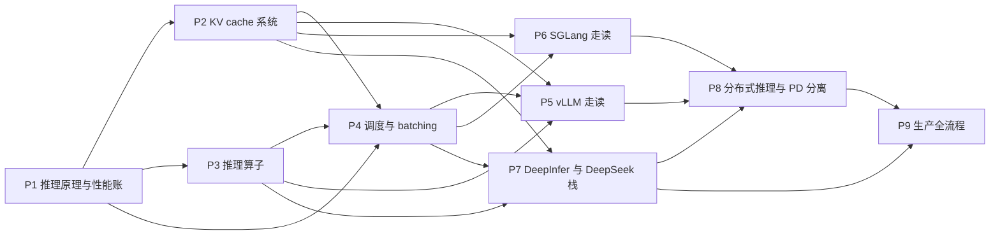

# inference 维度：目录、依赖图与进度表

inference 维度讲 serving 运行时系统——models 回答「模型是什么」（前向的数学），training 回答「参数怎么来」（反向、优化、并行与配方），inference 回答「模型如何以低延迟、低成本、高吞吐服务请求」：请求生命周期与 SLO 指标、prefill / decode 性能账与 roofline、采样与解码策略、KV cache 系统管理（paged / prefix / 量化 / 驱逐 / offload / 分层存储）、推理算子算法与系统接口、调度与 batching、投机解码、三大引擎代码走读（vLLM V1 / SGLang / DeepInfer）、serving 侧分布式并行与 PD 分离、弹性伸缩与容错、生产全流程，共 9 个 Part / 37 章。写法与 models / training 同规：公式级推导不跳步、逐公式附符号表、与官方实现代码对照；数值事实（带宽账 / 显存账 / 吞吐数字 / 生产披露 / config 字段）全部带出处并标注证据等级 [A]/[B]/[C]/[W]（定义见 [STYLE_GUIDE.md](../STYLE_GUIDE.md)；inference 对引擎/系统锚点的口径细化见 spec §4.1）；教材笔法（R2）自始适用（spec §4.6，无 retrofit 轮）。模型侧数学形式归 `models/`，训练侧并行算法与通信账归 `training/`，GPU silicon 实现归 `gpu/`，跨机通信硬件归 `cluster/`，交叉处只做纯文字指引、不重复展开（规则见 spec §2/§4.2）。V4.1-Flash 模型侧架构（CED / YOCO 混合注意力、Engram、DSpark draft 结构等）models 尚未覆盖，本维度只引用 config / DeepInfer 官方文档中与 serving 决策相关的事实（[W] / 官方披露口径），不做模型侧推导（形式化归 models，V4.1 待补）。边缘 / CPU 推理与非 LLM serving 不覆盖（spec §2）。

本文件是全维度唯一进度事实源：逐章状态见下方进度表，各波 evaluator 审查结论追加在文末审查记录区。章节大纲与波次划分的唯一设计事实源是 [spec](../docs/superpowers/specs/2026-11-22-inference-dimension-design.md)；文献索引与术语表见 [references.md](references.md)。

## 前置知识

- **models 维度 Part 1-2**：语言建模形式化（1.1）、参数/计算/内存的账（1.2）、Transformer 各组件推导（2.1-2.8，尤其 2.4 KV cache）——或同等知识；跨章引用一律纯文字（如「models 2.4 §5」）
- **models 维度 Part 4 相关章**：4.1（MLA 低秩推导、FlashAttention 前向数学与 online softmax）、4.2（sparse attention：SWA / NSA / DSA / MoBA）、4.5（MoE 路由与 MTP 目标）——本维度只 recap 一句 + 纯文字指引，不重复推导
- **training 维度 Part 5**：并行算法与通信账（TP f/g、PP 气泡、EP all-to-all 训练账）——或同等知识；RL rollout 的训练侧编排（四模型显存、权重同步）见 training 8.5 / 8.4，本维度 9.3 只取引擎侧增量
- 线性代数与概率论：同 models 维度；1.3 / 9.1 另需排队论直觉（M/M/1 章内建立）
- Python：能读 serving 栈源码——代码走读锚点是 vLLM、SGLang、DeepInfer、FlashInfer、TensorRT-LLM、LMDeploy 等 repo 的具体文件与函数

章节自包含：每个公式附符号表；跨章前置概念给纯文字指引，不重复展开。recap models / training 公式时一律把兄弟维度符号翻译为本维度约定（spec §4.3 翻译硬规则），附一句口径注。

锚定纪律：官方实现引用一律到 repo + 文件 + 函数级并记录核实日期；库内部类名/路径随版本漂移时，正文标注核实时的版本（如「此路径核实于 vLLM main，2026-11-22」）。

## 目录

### Part 1 · 推理原理与性能账（`01-principles-and-accounting/`，4 章，W1）

- 1.1 请求生命周期与 SLO 指标（`01-request-lifecycle-and-slos.md`）
- 1.2 Prefill / Decode 的算力与带宽账（`02-prefill-decode-accounting.md`）【重】
- 1.3 Roofline 与延迟-吞吐权衡（`03-roofline-and-tradeoffs.md`）
- 1.4 采样与解码策略（`04-sampling-and-decoding.md`）

### Part 2 · KV cache 系统（`02-kv-cache-systems/`，4 章，W1）

- 2.1 PagedAttention 与块管理（`01-paged-attention.md`）【重】
- 2.2 Prefix Caching 与 RadixAttention（`02-prefix-caching.md`）
- 2.3 KV 量化、驱逐与压缩（`03-kv-quantization-and-eviction.md`）
- 2.4 KV Offload 与分层存储（`04-kv-offload-and-tiering.md`）【重】

### Part 3 · 推理算子（`03-inference-operators/`，4 章，W2）

- 3.1 Decode Attention 算子族（`01-decode-attention-kernels.md`）【重】
- 3.2 权重量化算法（`02-weight-quantization.md`）【重】
- 3.3 量化 GEMM 与 Fused MoE 算子（`03-quantized-gemm-and-moe-kernels.md`）
- 3.4 融合、图捕获与编译（`04-fusion-and-graph-capture.md`）

### Part 4 · 调度与 batching（`04-scheduling-and-batching/`，5 章，W2）

- 4.1 Continuous Batching 与迭代级调度（`01-continuous-batching.md`）
- 4.2 调度器架构与抢占（`02-scheduler-and-preemption.md`）
- 4.3 Chunked Prefill 与混合批（`03-chunked-prefill.md`）【重】
- 4.4 投机解码原理与账（`04-speculative-decoding.md`）【重】
- 4.5 投机解码系统实现（`05-speculative-systems.md`）

### Part 5 · vLLM 走读（`05-vllm/`，4 章，W3）

- 5.1 vLLM V1 架构总览（`01-vllm-architecture.md`）
- 5.2 vLLM 调度器与 KV 管理器走读（`02-vllm-scheduler-kv.md`）
- 5.3 vLLM 分布式执行与编译（`03-vllm-distributed.md`）
- 5.4 vLLM 高级特性（`04-vllm-features.md`）

### Part 6 · SGLang 走读（`06-sglang/`，3 章，W3）

- 6.1 SGLang 架构与 RadixAttention 实现（`01-sglang-architecture.md`）
- 6.2 Overlap Scheduler 与零开销调度（`02-sglang-overlap-scheduler.md`）【重】
- 6.3 SGLang 分布式与 PD 分离（`03-sglang-distributed-pd.md`）

### Part 7 · DeepInfer 与 DeepSeek 栈（`07-deepinfer-and-deepseek/`，4 章，W4）

- 7.1 DeepInfer 架构走读（`01-deepinfer-architecture.md`）
- 7.2 DSpark 与 SWA Bounded Replay（`02-dspark-and-swa-replay.md`）【重】
- 7.3 DeepSeek 推理 Kernel 栈（`03-deepseek-kernel-stack.md`）
- 7.4 大规模 EP 部署与负载均衡（`04-deepseek-large-scale-ep.md`）

### Part 8 · 分布式推理与 PD 分离（`08-distributed-and-pd/`，5 章，W5）

- 8.1 Serving 侧并行策略与账（`01-serving-parallelism.md`）【重】
- 8.2 PD 分离原理（`02-pd-disaggregation.md`）【重】
- 8.3 KV 传输与互联（`03-kv-transfer.md`）
- 8.4 PD 分离系统实现对照（`04-pd-systems.md`）
- 8.5 弹性伸缩与容错（`05-elasticity-and-fault-tolerance.md`）

### Part 9 · 生产全流程（`09-production/`，4 章，W6）

- 9.1 容量规划与成本账（`01-capacity-and-cost.md`）【重】
- 9.2 其他推理引擎对照与选型（短篇）（`02-other-engines.md`）
- 9.3 RL Rollout Serving（`03-rl-rollout-serving.md`）
- 9.4 多模态与特殊 Serving（`04-multimodal-and-special-serving.md`）

## Part 依赖图

机制线 P1 → P2 / P3 → P4，引擎走读 P5 / P6 / P7 立于机制之上，分布式 P8 收三引擎的分布式实现，生产 P9 合流。四处章级前瞻引用（先于定义章使用、以回链闭合）：2.3 用量化格式记号（3.2 正式交付格式账，回链 2.3）；4.4 用 DSpark batch 效应动机（7.2 正式走读，回链 4.4）；4.5 用 DSpark 概念（7.2 正式走读，回链 4.5）；1.4 用结构化输出生产形态（9.4 正式展开 SO 专用机异步编译，回链 1.4）。

## 与 models / training 的接口

models / training 写于 inference 存在之前，交叉指针现泛指向本维度（或把 serving 主题判给 gpu / cluster），W1 起随章号生效经 errata 通道逐步收窄到章号或重判归属（spec §2）；全部指针、目标章号与收窄波次见文末「跨维度指针盘点」节。主要接口：

- [models 1.2 参数、计算、内存的账](../models/01-foundations/02-compute-accounting.md)：prefill / decode 算术强度（§10）→ 本维度 1.2 / 1.3 的 recap 入口；量化方法与精度损失 → 3.2
- [models 2.4 Causality 与 KV Cache](../models/02-transformer-anatomy/04-causality-and-kv-cache.md)：KV cache 容量式 (9)、算术强度式 (10)-(12) → 本维度 1.2 / 1.3 / 2.1 的 recap 入口；系统手段（paging / offload / 量化）→ P2
- [models 4.1 KV 压缩与精确 Attention 加速](../models/04-modern-architectures/01-kv-compression-and-exact-attention.md)：MLA 低秩推导与吸收形 → 3.1 / 7.3；FlashAttention 前向数学与 online softmax → 3.1 recap
- [models 4.5 MoE 与 MTP](../models/04-modern-architectures/05-moe.md)：MTP self-speculative 的系统侧（§6）→ 4.4 / 4.5 / 7.2；EP 接口的 EPLB 归属句（§7）重判 → 7.4 / 8.1
- [training 5.4 EP：专家并行与 All-to-All](../training/05-model-parallelism/04-expert-parallelism.md)：all-to-all 训练账 → 8.1 recap；EPLB 的 serving 侧（§4）→ 7.4 / 8.1
- [training 8.5 LLM-RL 的系统实现](../training/08-rl-math/05-llm-rl-systems.md)：rollout / train 引擎拆分、权重同步训练侧 → 9.3 引擎侧增量
- [training 6.3 现代训练栈对照与选型](../training/06-megatron-and-stacks/03-modern-training-stacks.md)：rollout 引擎内部机制指针 → 9.3 / P5-P6

## 进度表

状态取值与流转：未开始 → 已写（write pass 完成）→ 审查中（evaluator 对抗审查与修复进行中）→ 已关闭（S1/S2 findings 全部修复、复审通过）。更新规则：每章状态变化即改对应行，随同该波 commit 提交（spec §6.4 / §6.5）；其他文件不重复维护进度。

### Part 1 · 推理原理与性能账（W1）

| 章节 | 文件 | 状态 |
| --- | --- | --- |
| 1.1 请求生命周期与 SLO 指标 | 01-request-lifecycle-and-slos.md | 已关闭 |
| 1.2 Prefill / Decode 的算力与带宽账 | 02-prefill-decode-accounting.md | 已关闭 |
| 1.3 Roofline 与延迟-吞吐权衡 | 03-roofline-and-tradeoffs.md | 已关闭 |
| 1.4 采样与解码策略 | 04-sampling-and-decoding.md | 已关闭 |

### Part 2 · KV cache 系统（W1）

| 章节 | 文件 | 状态 |
| --- | --- | --- |
| 2.1 PagedAttention 与块管理 | 01-paged-attention.md | 已关闭 |
| 2.2 Prefix Caching 与 RadixAttention | 02-prefix-caching.md | 已关闭 |
| 2.3 KV 量化、驱逐与压缩 | 03-kv-quantization-and-eviction.md | 已关闭 |
| 2.4 KV Offload 与分层存储 | 04-kv-offload-and-tiering.md | 已关闭 |

### Part 3 · 推理算子（W2）

| 章节 | 文件 | 状态 |
| --- | --- | --- |
| 3.1 Decode Attention 算子族 | 01-decode-attention-kernels.md | 已关闭 |
| 3.2 权重量化算法 | 02-weight-quantization.md | 已关闭 |
| 3.3 量化 GEMM 与 Fused MoE 算子 | 03-quantized-gemm-and-moe-kernels.md | 已关闭 |
| 3.4 融合、图捕获与编译 | 04-fusion-and-graph-capture.md | 已关闭 |

### Part 4 · 调度与 batching（W2）

| 章节 | 文件 | 状态 |
| --- | --- | --- |
| 4.1 Continuous Batching 与迭代级调度 | 01-continuous-batching.md | 已关闭 |
| 4.2 调度器架构与抢占 | 02-scheduler-and-preemption.md | 已关闭 |
| 4.3 Chunked Prefill 与混合批 | 03-chunked-prefill.md | 已关闭 |
| 4.4 投机解码原理与账 | 04-speculative-decoding.md | 已关闭 |
| 4.5 投机解码系统实现 | 05-speculative-systems.md | 已关闭 |

### Part 5 · vLLM 走读（W3）

| 章节 | 文件 | 状态 |
| --- | --- | --- |
| 5.1 vLLM V1 架构总览 | 01-vllm-architecture.md | 已关闭 |
| 5.2 vLLM 调度器与 KV 管理器走读 | 02-vllm-scheduler-kv.md | 已关闭 |
| 5.3 vLLM 分布式执行与编译 | 03-vllm-distributed.md | 已关闭 |
| 5.4 vLLM 高级特性 | 04-vllm-features.md | 已关闭 |

### Part 6 · SGLang 走读（W3）

| 章节 | 文件 | 状态 |
| --- | --- | --- |
| 6.1 SGLang 架构与 RadixAttention 实现 | 01-sglang-architecture.md | 已关闭 |
| 6.2 Overlap Scheduler 与零开销调度 | 02-sglang-overlap-scheduler.md | 已关闭 |
| 6.3 SGLang 分布式与 PD 分离 | 03-sglang-distributed-pd.md | 已关闭 |

### Part 7 · DeepInfer 与 DeepSeek 栈（W4）

| 章节 | 文件 | 状态 |
| --- | --- | --- |
| 7.1 DeepInfer 架构走读 | 01-deepinfer-architecture.md | 已关闭 |
| 7.2 DSpark 与 SWA Bounded Replay | 02-dspark-and-swa-replay.md | 已关闭 |
| 7.3 DeepSeek 推理 Kernel 栈 | 03-deepseek-kernel-stack.md | 已关闭 |
| 7.4 大规模 EP 部署与负载均衡 | 04-deepseek-large-scale-ep.md | 已关闭 |

### Part 8 · 分布式推理与 PD 分离（W5）

| 章节 | 文件 | 状态 |
| --- | --- | --- |
| 8.1 Serving 侧并行策略与账 | 01-serving-parallelism.md | 已关闭 |
| 8.2 PD 分离原理 | 02-pd-disaggregation.md | 已关闭 |
| 8.3 KV 传输与互联 | 03-kv-transfer.md | 已关闭 |
| 8.4 PD 分离系统实现对照 | 04-pd-systems.md | 已关闭 |
| 8.5 弹性伸缩与容错 | 05-elasticity-and-fault-tolerance.md | 已关闭 |

### Part 9 · 生产全流程（W6）

| 章节 | 文件 | 状态 |
| --- | --- | --- |
| 9.1 容量规划与成本账 | 01-capacity-and-cost.md | 未开始 |
| 9.2 其他推理引擎对照与选型（短篇） | 02-other-engines.md | 未开始 |
| 9.3 RL Rollout Serving | 03-rl-rollout-serving.md | 未开始 |
| 9.4 多模态与特殊 Serving | 04-multimodal-and-special-serving.md | 未开始 |

## 审查记录

各波 evaluator 对抗审查的结论追加在此处（流程、severity 分级与 verification log 要求见 spec §6.3）。此处只记汇总；完整 findings 表与 verification log 存各波审查档案（`docs/reviews/`）。

| 波次 | 日期 | 覆盖章节 | 审查轮次 | S1 | S2 | S3 | 未关闭项 | 结论 |
| --- | --- | --- | --- | --- | --- | --- | --- | --- |
| W0 | 2026-11-22/23 | spec 本身（9 Part / 37 章大纲）+ 脚手架 | 四路独立对抗审查 ×1（A: P1–P4 事实与数学 / B: P5–P7 引擎走读与 DeepInfer 一手来源 / C: P8–P9 分布式与 PD / 生产 / D: 设计与一致性）+ builder-check ×1 + 逐任务 fresh reviewer ×6（Tasks 1–6） | 0 | 17（raw 19，去重后全部关闭） | 29（raw 36，去重后全部清零） | 无 | **放行（W1 开工放行）**。spec 审查闭环：四路完整档案见 [inference-spec-review-a](../docs/reviews/inference-spec-review-a.md) / [b](../docs/reviews/inference-spec-review-b.md) / [c](../docs/reviews/inference-spec-review-c.md) / [d](../docs/reviews/inference-spec-review-d.md)，spec 附录有汇总。脚手架全绿：references 9 Part 分组 77 条（术语表 80）；本 README 37 章进度表 + 18 边依赖图 + 28 行跨维度指针盘点；lint inference 分支激活（models 51 + training 39 共 90 章回归全过）；STYLE_GUIDE 泛化至三维度（条款零漂移 + 前言 [A] 让位）；站点 DIMENSIONS inference 起步断言 0/0（refsMin 50）+ 完整 UI 对象 + 18 边依赖图 + FORTHCOMING.inference 移除；全量 QA 绿（116 页 / 3750 站内引用 / 26 截图，2026-11-23 收官终检复跑） |
| W1 | 2026-11-23 | P1+P2 8 章（1.1–1.4 / 2.1–2.4） | 逐批审查 ×2（P1/P2）+ 修复轮 ×2 + 复审 ×2（fix-review + NB-1/NB-2 scoped） | 2 | 5 | 12 | 无 | **放行**。档案 [inference-w1-review-p1](../docs/reviews/inference-w1-review-p1.md)（S1=0/S2=1/S3=5）/ [p2](../docs/reviews/inference-w1-review-p2.md)（S1=2/S2=3/S3=6）/ [fix-review](../docs/reviews/inference-w1-fix-review.md)（原 S1/S2 全 ADDRESSED + fix-introduced NB-1（S2）/NB-2（S3）修复后 scoped 复核 clean）；强制重推导 1.2/2.1/2.4 全 PASS；16 场景图 QUALITY 五维 ≥4；refs 被引回写（parse 9 组 / 79 条）；站点断言 {8,2} QA 全绿。残留观察 2.2 PCIe 双向/单向口径 S3（robust，重叠结论不变）留 W2 |
| W2 | 2026-11-23 | P3+P4 9 章（3.1–3.4 / 4.1–4.5） | 逐批审查 ×2（P3/P4）+ 修复轮 ×1（6 writers）+ 复审 ×1（fix-review） | 0 | 13 | 21 | 无 | **放行**。档案 [inference-w2-review-p3](../docs/reviews/inference-w2-review-p3.md)（S2=9/S3=14）/ [p4](../docs/reviews/inference-w2-review-p4.md)（S2=4/S3=7）/ [fix-review](../docs/reviews/inference-w2-fix-review.md)（13 S2 全 ADDRESSED + 21 S3 全修，无新 S1/S2）；强制重推导 3.1/3.2/3.3/4.2/4.3/4.4 全 PASS；24 场景图 QUALITY 五维 ≥4；refs 被引回写（parse 9 组 / 79 条）；站点断言 {17,4} QA 全绿。W1 残留 2.2 PCIe 口径注 + 2.1 参考补 v41-flash-config 已闭环；fix-review 残留 3 处 S3 外观项（3.1 英中空格 ×2 / 4.4 γ 表 γ=8 格 2.41→2.40 / 3.2 总结表 AWQ 行图 2 口径标）收官顺手清；4.5 EAGLE README 措辞 reconciling 注（可选）留 W3 |
| W3 | 2026-11-23 | P5+P6 7 章（5.1–5.4 / 6.1–6.3） | 逐批审查 ×2（P5/P6）+ 修复轮 ×1（4 writers）+ 复审 ×1（fix-review，fresh-context） | 0 | 14 | 18 | 无 | **放行**。档案 [inference-w3-review-p5](../docs/reviews/inference-w3-review-p5.md)（S2=11/S3=13）/ [p6](../docs/reviews/inference-w3-review-p6.md)（S2=3/S3=5+ERR-1）/ [fix-review](../docs/reviews/inference-w3-fix-review.md)（14 S2 全 ADDRESSED、18 S3 全修，无新 S1/S2）；强制重推导 6.2 bubble 消除账 + FutureMap resolve 正确性 PASS（pacing 保持步修复后独立重推）；23 场景图 QUALITY 五维 ≥4（part05=14 / part06=9）；refs 被引回写（8 条目按实际引用更新，parse 9 组 / 81 条）；站点断言 {24,6} QA 全绿。收官清 fix-review 残留 3 处 S3 recap-sync（5.4 ASCII / 总结 MTP 薄壳措辞、5.3 总结 kv_hints 消费链顺序）+ 2 条 errata（3.4 编译指针 6.2→6.3、1.4 sampling 新路径），4 章 re-lint OK；W2 carryover errata（11 处指针收窄 + 4.5 EAGLE 注）随本波 commit |
| W4 | 2026-11-23 | P7 4 章（7.1–7.4）+ 跨波 MLA errata 7 章（1.2 / 2.1 / 2.3 / 2.4 / 3.1 / 5.2 / 5.3） | P7 审查 ×1 + 修复轮 ×1（3 writers + 跨波 errata）+ 复审 ×1（fix-review，fresh-context）+ 5.2 残留 fix | 1（跨波 X-1） | 4 | 12 | 无 | **放行**。档案 [inference-w4-review-p7](../docs/reviews/inference-w4-review-p7.md)（S1=1 跨波 X-1 / S2=4 / S3=12）/ [fix-review](../docs/reviews/inference-w4-fix-review.md)（X-1 ADDRESSED、4 S2 全 ADDRESSED、12 S3 全修或按裁定留 closeout、5.2 残留裁定 fix-to-V4.1 已执行）；强制重推导 7.2 DSpark 期望吞吐 / SWA 恒定成本 / hit policy PASS；16 P7 场景图 QUALITY 五维 ≥4；X-1 跨波数值 errata：V4.1-Flash MLA 几何 576→512 元素（kv_lora_rank 448 + rope 64）纠正 7 章、V3 行不动（四方 config 证据，详见下方专段）；refs 被引回写（9 条目按实际引用更新，parse 9 组 / 82 条）；S3-11 三指针 errata（training 5.4 / models 4.5 EPLB 归属重判 → 7.4，8.1 recap 待 W5）+ W3 carryover errata 闭环（training 8.5 两处指针收窄）；站点断言 {28,7} QA 全绿（build:content inference 28 章 / 7 Part / 82 refs + models 51 / training 39 回归；153 页 / 4797 站内引用 / pagefind 118 页 98566 词 / qa-shots 27 样页 × 桌面移动全过含 W4 3 新样页；og.png 复原）。无大纲偏差。残留：fix-review 非阻塞观察 2 项（7.2 总结 / 练习 3(c) bit-exact 简写可选补「与存储态」限定、7.2 L264 口径注 errata 后读作历史记录）留后续 |
| W5 | 2026-11-23/24 | P8 5 章（8.1–8.5） | P8 审查 ×1 + 修复轮 ×1（4 writers）+ 复审 ×1（fix-review，fresh-context） | 0 | 6 | 9 | 无 | **放行**。档案 [inference-w5-review-p8](../docs/reviews/inference-w5-review-p8.md)（S1=0/S2=6/S3=9）/ [fix-review](../docs/reviews/inference-w5-fix-review.md)（6/6 S2 全 ADDRESSED、S3 章侧 7/7 修复确认、refs/notes 侧 3 项 closeout 闭环、反转义 5 章 ×9 禁用形全 0、python 53/53 断言 PASS、无新破坏）；强制重推导 8.1 TP 2× 延迟账 / DP attention 通信账 + 8.2 DistServe goodput 调和分解 / xPyD 配比 / 传输 vs 重算 BW* 带宽阈值全 PASS（命题 4 故障吸收不等式方向独立重推 PASS，下界 f_max=1−u ≥ 1−u_max）；19 P8 场景图 QUALITY 五维 ≥4（part08=19；fig-check 收官复跑 19 全渲染、19 data-fig 锚对 census 4/4/5/2/4）；refs 被引回写（12 条目 18 对按章内实际引用更新，S3-7 flagged 全覆盖，forward+reverse 机械交叉核 clean；parse 9 组 / 83 条）+ nixl 插件计数 19→18 收窄（S3-8，evaluator tarball cb66ce83 裁定）+ bounce「均」→「平均」（S2-4，refs tensorrt-llm / research notes / 8.4 总结练习压缩表述补齐）；W5 指针 errata 6 处（models 1.2 §10 / models 2.4 §6 +8.2、models 4.5 §7 + 总结表 / training 5.4 §4 EPLB「8.1 recap 待 W5」→「8.1 §4 recap」、models 2.8 §4 TP 系统展开归属重判 → training 5.1 / inference 8.1，盘点表 W5 裁定行），5 章 re-lint OK；站点断言 {33,8} QA 全绿（build:content inference 33 章 / 8 Part / 83 refs + models 51 / training 39 回归；159 页 / 4973 站内引用 / pagefind 123 页 101251 词 / qa-shots 30 样页 × 桌面移动全过含 W5 3 新样页 8.2/8.3/8.5；og.png 复原）。无大纲偏差。残留：lint display 反转义漏检 advisory（lint-math-boundary.py 剥 display 后扫描不覆盖 `\,`/`\!` 陷阱，本轮 raw 扫描补偿）留 W7；W4 carryover 2 处指针收窄未执行（models 4.1 §4.4 吸收形 → 7.3 部分、models 4.5 §6.2 DSpark → 7.2 部分，目标非 W5 章）留 W6 |

**跨维度指针 errata 记录**（spec §2 条款授权，仅限指针句的最小修订；errata 编辑不跑 rewrite-gate）：

| 日期 | 位置 | 修订 |
| --- | --- | --- |
| 2026-11-23 | models 1.2 §8（L187） | 「这是 2.4 与 inference 维度展开的话题」→「这是 2.4 与 inference 1.2 / 2.4 展开的话题」（cache 读取带宽账 → 1.2 decode KV 读账 / 2.4 分层传输账） |
| 2026-11-23 | models 1.2 §10（L245） | 「（具体数值属 gpu 维度）」→「（逐卡 datasheet 参数表见 inference 1.3，微架构来源与测量方法归 gpu 维度）」（重判，spec §2 裁定 (1) 同型句） |
| 2026-11-23 | models 1.2 §10（L247） | 「（系统展开属 inference 维度）」→「（系统展开属 inference 1.1 / 1.2）」（部分收窄：4.3 / 8.2 部分待 W2 / W5） |
| 2026-11-23 | models 2.4 §5（L199） | 「属 inference 维度」→「属 inference 2.3」（cache 量化砍每元素字节数） |
| 2026-11-23 | models 2.4 §5（L212） | 「inference 维度的系统手段（paging、offload、量化）」→「inference 2.1 / 2.4 / 2.3 的系统手段（paging、offload、量化）」 |
| 2026-11-23 | models 2.4 §6（L216） | 「（逐卡数字与测量方法归 gpu 维度）」→「（逐卡 datasheet 参数表见 inference 1.3，微架构来源与测量方法归 gpu 维度）」（重判，spec §2 裁定 (1)） |
| 2026-11-23 | models 2.4 §6（L244） | 「系统展开属 inference 维度；roofline 的逐卡参数属 gpu 维度」→「系统展开属 inference 1.2 / 1.3；roofline 的逐卡 datasheet 参数表归 inference 1.3，微架构来源与测量方法归 gpu 维度」（部分收窄：8.2 部分待 W5；重判，裁定 (1)） |
| 2026-11-23 | models 2.4 §7（L256） | 「inference 维度接管 §6 的系统后果」→「inference 1.2 / 2.1 接管 §6 的系统后果」 |
| 2026-11-23 | models 4.1 §1（L7） | 「b 的量化归 inference 维度」→「b 的量化归 inference 2.3」 |
| 2026-11-23 | models 4.8 §5（L96） | 「（prefix caching 的调度与命中归 inference 维度）」→「（prefix caching 的调度与命中归 inference 2.2）」 |
| 2026-11-23 | models 4.8 总结表（L112） | 「前缀共享（归 inference）」→「前缀共享（归 inference 2.2）」 |
| 2026-11-23 | training 8.5 §2（L46） | 「归 inference 维度的账」→「归 inference 2.1 的账」（rollout KV 容量账） |
| 2026-11-23 | training 8.5 §3（L52） | 「内部机制归 inference 维度」→「内部机制归 inference 维度（PagedAttention 与分页管理见 inference 2.1）」（部分收窄：连续批处理 4.1 待 W2、模块走读 5.2 待 W3） |
| 2026-11-23 | models 1.1 §8（L270） | 「属于 inference 维度」→「属于 inference 维度（KV cache 见 2.1、批处理见 4.1、投机采样见 4.4，采样策略工程见 1.4）」（全收窄：四目标章均已发布；README 活链接保留作维度入口） |
| 2026-11-23 | models 1.2 §8（L155） | 「（量化方法与精度损失属 inference 维度）」→「（量化方法与精度损失属 inference 3.2）」（三族算法 §3–§7 + 质量评估口径 §8） |
| 2026-11-23 | models 1.2 §10（L247） | 「（系统展开属 inference 1.1 / 1.2）」→「（系统展开属 inference 1.1 / 1.2 / 4.3）」（W1 部分收窄续：prefill/decode 混合批调度 → 4.3；8.2 待 W5） |
| 2026-11-23 | models 2.4 §6（L242） | 「inference 维度把 continuous batching 与 cache 压缩放在一起优化」→「inference 4.1 / 2.3 把 continuous batching 与 cache 压缩放在一起优化」（章号与两主题按位对应） |
| 2026-11-23 | models 4.1 §4.4（L213） | 「归 inference 维度」→「归 inference 3.1」（部分收窄：吸收形 kernel 几何 → 3.1 §5 FlashMLA；7.3 待 W4） |
| 2026-11-23 | models 4.1 §5.4（L298） | 「kernel 实现归 gpu 维度」→「算法与策略级见 inference 3.1，指令级 kernel 实现归 gpu 维度」（重判：FA2/FA3 并行与流水策略级 → 3.1 §3，指令级仍归 gpu） |
| 2026-11-23 | models 4.1 §6（L302） | 「是 gpu 维度 kernel 章的入口」→「是 inference 3.1 的入口（指令级 kernel 实现归 gpu 维度）」（重判：IO 账经 3.1 §1 recap 为算法级入口） |
| 2026-11-23 | models 4.1 总结表（L316） | 「细节归 gpu」→「算法级见 inference 3.1，指令级归 gpu」（重判，与 L298 同口径） |
| 2026-11-23 | models 4.5 §6.2（L309） | 「归 inference 维度」→「归 inference 4.4 / 4.5」（部分收窄：验证-batch 交互 → 4.4 §6 / 4.5 §6，拒绝 KV 回滚与 draft/主干隐藏态复用接口 → 4.5 §3/§5；7.2 待 W4） |
| 2026-11-23 | training 5.4 §6（L95） | 「kernel 实现归 gpu/cluster 维度，本书不展开」→ 同句 +「（serving 侧 dispatch / combine 语义与账见 inference 3.3）」（补指针：3.3 §6 已 recap training 5.4 §6 并立 serving 侧增量；指令级仍归 gpu/cluster） |
| 2026-11-23 | training 8.5 §3（L52） | 「（PagedAttention 与分页管理见 inference 2.1）」→「（PagedAttention 与分页管理见 inference 2.1，连续批处理见 4.1）」（W1 部分收窄续；5.2 待 W3） |
| 2026-11-23 | inference 3.4 §1（L7）+ §4（L99） | 「引擎编译模块全量走读归 5.3 / 6.2」→「归 5.3 / 6.3」；「SGLang 归 6.2」→「SGLang 归 6.3」（维度内指针纠正：compilation 走读在 6.3 §8 交付，6.2 是 overlap scheduler——W3 P6 审查 ERR-1，spec §5 6.3 大纲口径） |
| 2026-11-23 | inference 1.4 §3（L55）+ 参考（L208） | sampling 实现锚「`vllm/v1/sample/`」→「`vllm/v1/worker/gpu/sample/sampler.py` L42（`v1/sample/` 只剩 ops/，2026-11-23 main 核实；走读见 5.4 §7）」（维度内指针纠正：Sampler 与 processor 链已迁 worker 侧——W3 P5 审查 advisory，5.4 §7 坑注同口径） |
| 2026-11-23 | training 8.5 参考（L219） | 「（内部机制归 inference 维度）」→「（内部机制归 inference 5.1 / 5.2）」（W3 carryover 收窄：vLLM 条目内部机制 → 5.1 架构总览 / 5.2 调度器与 KV 管理器走读；盘点表 W3 行闭环，两章均引用 vllm 论文锚） |
| 2026-11-23 | training 8.5 §3（L52） | 「（PagedAttention 与分页管理见 inference 2.1，连续批处理见 4.1）」→「（PagedAttention 与分页管理见 inference 2.1，连续批处理见 4.1，模块走读见 5.2）」（W1/W2 部分收窄续：模块走读 → 5.2，目标 2.1 / 4.1 / 5.2 全收窄） |
| 2026-11-23 | inference 1.2 §3（L53 坑注 / L63 表行 / L66）+ §7 汇总表 + 总结 + 练习 1 | **数值 errata（X-1）**：V4.1 MLA 几何 576→512 元素（448 latent + 64 rope；head_dim 512 已含 rope，config 无 kv_lora_rank 字段、引擎导出 448）——κ 1152→1024 B、45→40 KiB/token（40960 B）、误代高估 1.78→2.0×（1024 vs 512）；删「config 读 kv_lora_rank」句改引擎读法；V3 行（576/1152/68.6 KiB/10.7 GiB）不动 |
| 2026-11-23 | inference 2.1 §6（L240）+ 参考（L295） | **数值 errata（X-1 同族）**：V4.1 config 几何描述「d_latent = 512、d_rope = 64」→「共享 KV 向量 512 元素 = 448 latent + 64 rope（head_dim 512 已含 rope，kv_lora_rank 448 引擎导出）」（config 未声明 d_latent 512；本章无派生字节，仅几何描述纠正） |
| 2026-11-23 | inference 2.3 §1 章口径 + §4（L90 推导 / L92 坑注）+ 总结 + 参考 | **数值 errata（X-1）**：V4.1 主 KV FP4 576 元素/324 B→512 元素/288 B（256 数据 + 32 scale）、bf16 1152→1024 B、12960→11520 B/token（12.7→11.25 KiB）、满窗 12.7→11.25 GiB / bf16 45→40 GiB、e4m3 误读 612 vs 324→544 vs 288（1.89× 不变）、压缩 3.56× 不变；§6 V3 口径行（576/32768/56.9×）不动 |
| 2026-11-23 | inference 2.4 章脊（L9）+ §8（L159）+ §9（L175）+ 总结 + 练习 1 + 参考 | **数值 errata（X-1）**：V4.1 κL 46080→40960 B/token（45→40 KiB）、同 T 单序列 1.41→1.25 GiB、主 KV 低精度 12.7→11.25 KiB/token、GQA 对照 2.8→3.2× / 10→11.4×；「512 维 latent」→「512 维共享 KV 向量（448 latent + 64 rope）」（528 / 1,415,040 数值已对、不动） |
| 2026-11-23 | inference 3.1 §7（走读图 / L277 / 式 (10) 代入）+ 总结（+ site inference-part03.mjs DSA 场景图同步） | **数值 errata（X-1）**：式 (10) κ 1152→1024 B、M_main 22.5→20 MiB（全量对照 5.625→5 GiB）、indexer/主路 56.9→64×、MXFP4 仍 15→17×（省 3.76× 不变）、「128 对主路 576」→512；§5 V3 吸收形（576/656/241.8/57×）不动 |
| 2026-11-23 | inference 5.3 §7（L266/L291/L293）+ 总结 + 练习 3 | **数值 errata（X-1）**：HiSparse 账 κ 1152→1024 B、hot buffer 47.2 MB（45 MiB）→41.9 MB（40 MiB）、全量 6.04→5.37 GB、B=64 hot 3.02→2.68 GB / 全量 386.5→343.6 GB、换入 22.5→20 MiB / 0.37→0.33 ms（驻留 0.78% 不变） |
| 2026-11-23 | inference 5.2 §6（L130）+ 总结（L209）+ 练习 2(c)（L219）（+ site inference-part05.mjs L323/L392 两图同步） | **数值 errata（X-1 同族，fix-review §3 裁定 fix-to-V4.1）**：MLA 块几何例 d_K 576→512（V4.1 共享 KV 向量 448+64）、state_content/κ 1152→1024 B、page 72→64 KiB；「由 latent 维定」→「由共享 KV 向量维（latent+rope）定」；练习 2(c) κ 1152→1024、分母 2.81→2.5 MiB、num_blocks 17476→19660（19660.8 向下取整）；provenance = errata 前 1.2/2.1 V4.1 行逐字同源、非 V3 例（[inference-w4-fix-review](../docs/reviews/inference-w4-fix-review.md) §3） |
| 2026-11-23 | training 5.4 §4（L79） | 「EPLB 一类的系统实现归 cluster 维度」→「EPLB 的 serving 侧部署与算法归 inference 7.4（8.1 recap 待 W5），硬件 / 网络拓扑归 cluster 维度」（重判，spec §2 裁定 (2)；7.4 §3/§4 已交付 EPLB 两套算法走读与 moe_lb 账，8.1 待 W5——W4 S3-11） |
| 2026-11-23 | models 4.5 §7（L327） | 「硬件与网络侧（all-to-all 的带宽与拓扑、EPLB 的系统实现）归 cluster 维度」→「硬件与网络侧（all-to-all 的带宽与拓扑）归 cluster 维度，EPLB 的 serving 侧部署与算法归 inference 7.4（8.1 recap 待 W5）」（重判，spec §2 裁定 (2)；all-to-all 带宽/拓扑仍归 cluster——W4 S3-11） |
| 2026-11-23 | models 4.5 总结表 EP 行（L345） | 「拓扑与 EPLB 实现归 cluster 维度」→「拓扑归 cluster 维度，EPLB serving 侧实现归 inference 7.4（8.1 recap 待 W5）」（重判，同上——W4 S3-11） |
| 2026-11-23 | models 1.2 §10（L247） | 「（系统展开属 inference 1.1 / 1.2 / 4.3）」→「（系统展开属 inference 1.1 / 1.2 / 4.3 / 8.2）」（W1/W2 部分收窄续：prefill/decode 分开调度分开定价 → 8.2 PD 分离原理；9.1 成本账待 W6） |
| 2026-11-23 | models 2.4 §6（L244） | 「系统展开属 inference 1.2 / 1.3」→「系统展开属 inference 1.2 / 1.3 / 8.2」（W1 部分收窄续：两阶段瓶颈 → 调度与定价分离 → 8.2；roofline 参数表重判句不动） |
| 2026-11-23 | models 4.5 §7（L327） | 「inference 7.4（8.1 recap 待 W5）」→「inference 7.4（8.1 §4 recap）」（W4 S3-11 收窄续：8.1 §4 已交付 EPLB 冗余副本 + 统计窗 + 重分配与 moe_lb 残差偏斜 recap） |
| 2026-11-23 | models 4.5 总结表 EP 行（L345） | 「inference 7.4（8.1 recap 待 W5）」→「inference 7.4（8.1 §4 recap）」（同上） |
| 2026-11-23 | training 5.4 §4（L79） | 「inference 7.4（8.1 recap 待 W5）」→「inference 7.4（8.1 §4 recap）」（同上） |
| 2026-11-23 | models 2.8 §4 提点（L367） | 「其系统展开属 cluster 维度」→「其系统展开训练侧归 training 5.1、serving 侧归 inference 8.1，硬件互联归 cluster 维度」（重判，spec §2 三层划分同型句：TP serving 侧延迟账 8.1 §2 已交付、训练侧通信账 training 5.1、硬件互联仍归 cluster——盘点表 W5 裁定行，「每层 all-reduce 次数」账面量句不动） |

（W0 只盘点、无编辑；W1 起随章号生效的每次最小修订逐条记入上表。）

**W1 残留修复（2026-11-23，非指针 errata，W2 开工前顺手闭环）**：2.1 参考节补 v41-flash-config 条目（对应 §6 既有行内引用，refs 被引章节字段已含 2.1，无需改 references.md）；2.2 §5 补 PCIe 单向/双向口径注（W1 fix-review R-1 闭环：本例 128 GB/s 为单向 H2D 乐观口径，2.4 §1 双向合计口径下约 262 μs、裕量约 7.4 倍，重叠结论不变，数值未改）。两章 re-lint LINT OK。

**W2 残留修复（2026-11-23，非指针 errata，W3 开工前顺手闭环）**：4.5 §1 L41 补 EAGLE README 措辞 reconciling 注（W2 fix-review §3 观察项 2 闭环：README 的「top-layer」泛指 EAGLE-1/2 所用的单层 feature，即 §1 的倒数第二层 feature，论文摘要口径 second-to-top-layer；两处来源措辞各自忠实引用，注只桥接、数值未改）。该章 re-lint LINT OK。

**W4 跨波数值 errata（2026-11-23，非指针 errata，X-1 裁定执行）**：W4 P7 审查（[inference-w4-review-p7](../docs/reviews/inference-w4-review-p7.md) finding X-1 / §2 裁定）裁定 W1/W2/W3 章的 V4.1-Flash MLA 几何为**事实错误而非口径差异**——把 config `head_dim` 512 误读为 kv_lora_rank 再加 rope 64 得 576 元素（V3 几何误套 V4.1，重复计 rope）。真值 = **512 元素 = kv_lora_rank 448 + rope 64**，四方一手互证：① config 无 kv_lora_rank 字段（hf-mirror 200 / 3,311 B 全字段核）；② DeepInfer hugging_face/config.py L288-289 注释逐字「HF's shared KV vector includes RoPE; the internal rank excludes it.」+ kv_lora_rank = head_dim − qk_rope_head_dim = 448；③ cache_common.py V41_FORMAT quantized_elements=512 + cache_engine.py L54 assert 和=512；④ FlashMLA main README 528/288 B 覆盖全部 512 维（64 RoPE 维也量化）/ 旧 README head_dim_k 576（V3 系）/ 512（V4/V4.1）+ doc L223 官方 528 B/token。执行范围：1.2 / 2.1 / 2.3 / 2.4 / 3.1 / 5.3 六章（含 X-1 行清单外同族位置：2.4 章脊 / §9 / 总结 / 练习、5.3 §7 热区账 / 总结 / 练习、2.1 §6 几何描述）+ 3.1 §7 DSA 场景图（site/scripts/lib/figures/inference-part03.mjs）同步；全部派生值 python 独立重算（55 断言全 PASS），比值类结论（压缩 3.56×、e4m3 误读 1.89×、MXFP4 省 3.76×、驻留 0.78%）线性缩放不变。**V3 口径行全部不动**（1.2 L62、2.3 L124、3.1 §5 吸收形 576/656、6.3 的 61 层 1152/70272）。六章 re-lint LINT OK；场景图模块 12 图渲染自检过。P7 章内几何口径簇（S2-1/2/3）已同步在案（7.1 §5 config 表 / 7.2 §9 口径注 / 7.3 §1/§3，均 512 元素引擎读法）。**5.2 残留续修（fix-review §3 裁定 fix-to-V4.1）**：原 flagged 的 5.2 §6 MLA 块几何例 + 练习 2(c) 经 [inference-w4-fix-review](../docs/reviews/inference-w4-fix-review.md) §3 裁定为 X-1 清单外传播（provenance = errata 前 1.2/2.1 V4.1 行逐字同源，非 V3 例），已修到 V4.1 口径（d_K 512 / κ 1024 B / page 64 KiB / 练习分母 2.5 MiB / num_blocks 19660）+ part05 两图同步，5.2 re-lint LINT OK、part05 fig-check 14 图过；同簇标签卫生：part02 L334 / part06 L174 的 V3 图标签补「V3」代际 tag（fix-review §3.6，非事实错）。七章累计 re-lint 全 OK。

## 跨维度指针盘点

W0 对 models / training 已发布文本的全部交叉指针盘点（spec §2 errata 通道）。两种扫描模式：① 泛指向 inference——`/usr/bin/grep -rn 'inference'` 六个种子文件（models 2.4 / 4.1 / 4.5、training 8.5 / 6.3 / 5.4）+ 全维度 sweep（`inference 维度 / 归 inference / 推理维度`）；② 指向错误维度的 serving 指针——`归 gpu / 属 gpu / 归 cluster / 属 cluster` 归属句 sweep（training 5.4 EPLB→cluster 即一例，只按模式①扫描会漏）。命中中的代码路径（如 DeepSeek-V3 `inference/model.py`）与公式标签（如 TC 式的 inference 项）不是交叉指针，不入表。**W0 只盘点记录，不改 models / training 文本**；W1 起随章号生效经 errata 通道收窄到章号或重判归属（仅限指针句最小修订，不动公式与数值），逐条记入上方审查记录区 errata 表。「收窄波次」= 主要目标章生效波次（跨波指针可分批收窄）。行号为 2026-11-22 核实口径（HEAD d684f05），文本若有修订按指针句重定位。

| 位置 | 现指针 | 目标章号 | 收窄波次 |
| --- | --- | --- | --- |
| models 1.1 §8（L270） | 「生成阶段的系统工程（KV cache、批处理、投机采样）属于 inference 维度」（活链接指向本 README） | 1.4 / 2.1 / 4.1 / 4.4 | W2 |
| models 1.2 §8（L155） | 「量化方法与精度损失属 inference 维度」 | 3.2 | W2 |
| models 1.2 §8（L187） | cache 读取带宽账「是 2.4 与 inference 维度展开的话题」 | 1.2 / 2.4 | W1 |
| models 1.2 §10（L245） | 「峰值 FLOPS ÷ 显存带宽……具体数值属 gpu 维度」 | 重判：datasheet 参数表 → 1.3，微架构 → gpu（spec §2 裁定 (1) 同型句） | W1 |
| models 1.2 §10（L247） | 「推理系统因此把 prefill 与 decode 分开调度、分开定价（系统展开属 inference 维度）」 | 1.1 / 1.2 / 4.3 / 8.2 | W1 |
| models 2.4 §5（L199） | 「cache 量化（int8 / fp8 等）……属 inference 维度」 | 2.3 | W1 |
| models 2.4 §5（L212） | 「inference 维度的系统手段（paging、offload、量化）」 | 2.1 / 2.4 / 2.3 | W1 |
| models 2.4 §6（L216） | 「逐卡数字与测量方法归 gpu 维度」 | 重判：datasheet 参数表 → 1.3，微架构与测量方法 → gpu（spec §2 裁定 (1)） | W1 |
| models 2.4 §6（L242） | 「inference 维度把 continuous batching 与 cache 压缩放在一起优化」 | 4.1 / 2.3 | W2 |
| models 2.4 §6（L244） | 「系统展开属 inference 维度；roofline 的逐卡参数属 gpu 维度」 | 系统展开 → 1.2 / 1.3 / 8.2；逐卡参数重判 → 1.3（spec §2 裁定 (1)） | W1 |
| models 2.4 §7（L256） | 「inference 维度接管 §6 的系统后果」 | 1.2 / 2.1 | W1 |
| models 4.1 §1（L7） | 「b 的量化归 inference 维度」 | 2.3 | W1 |
| models 4.1 §4.4（L213） | 「吸收形的 kernel 化是推理框架的事，归 inference 维度」 | 3.1 / 7.3 | W2 |
| models 4.1 §6（L302）+ 总结表（L316） | FA IO 复杂度「是 gpu 维度 kernel 章的入口」；FA2 / FA3「细节归 gpu」 | 重判候选：算法与策略级 → 3.1，指令级 → gpu（spec §2 例 list 列 models 4.1 §6） | W2 |
| models 4.5 §6.2（L309） | MTP「系统侧问题——验证步与 batch 的交互、拒绝时 KV cache 的处置、草稿与主模型的算子融合——归 inference 维度」 | 4.4 / 4.5 / 7.2 | W2 |
| models 4.5 §7（L327） | 「硬件与网络侧（all-to-all 的带宽与拓扑、EPLB 的系统实现）归 cluster 维度」 | 重判：serving 侧 EPLB → 7.4（8.1 recap），硬件 / 拓扑 → cluster（spec §2 裁定 (2)） | W4 |
| models 4.5 总结表 EP 行（L345） | 「拓扑与 EPLB 实现归 cluster 维度」 | 同上 | W4 |
| models 4.8 §2（L66） | MoD / early-exit「kernel 与流水线的处理归 inference 与 cluster 维度」 | 本维度无专章，保留泛指向 | — |
| models 4.8 §5（L96） | 「prefix caching 的调度与命中归 inference 维度」 | 2.2 | W1 |
| models 4.8 总结表（L112） | 「前缀共享（归 inference）」 | 2.2 | W1 |
| training 5.4 §4（L79） | 「EPLB 一类的系统实现归 cluster 维度」 | 重判：serving 侧 EPLB → 7.4 / 8.1，硬件 → cluster（spec §2 裁定 (2)） | W4 |
| training 5.4 §6（L95） | DeepEP「kernel 实现归 gpu/cluster 维度，本书不展开」 | 线索：可补 serving 侧语义与账指针 → 3.3（指令级仍归 gpu） | W2 |
| training 6.3 §5（L87 图 + L91） | 「rollout 引擎的内部机制归 inference 维度，只链接」 | 9.3（引擎机制见 P5 / P6） | W6 |
| training 8.5 §2（L46） | rollout KV「归 inference 维度的账」 | 2.1 | W1 |
| training 8.5 §3（L52） | 「推理引擎（vLLM）的 PagedAttention、连续批处理、KV cache 分页管理……内部机制归 inference 维度」 | 2.1 / 4.1 / 5.2 | W1 |
| training 8.5 参考（L219） | vLLM 条目「（内部机制归 inference 维度）」 | 5.1 / 5.2 | W3 |
| models 2.8 §4 提点（L367） | 「TP 系统展开属 cluster 维度」 | 线索：训练侧归 training 5.1、serving 侧归 8.1；是否修订属 models errata 裁定 | W5 |
| models 1.2 §9（L228）/ models 5.2 §3.4（L90） | H800 峰值口径与 MFU 反推「属 gpu（与 training）维度」 | 训练侧 MFU 账，保留；datasheet 数字可参照 1.3 参数表（非必须） | — |

**Task 1 errata 对照**（spec §2 三层划分裁定，四路审查 C-S2-5 / D-S2-4）：

- EPLB 归属句（表中 models 4.5 §7 / 总结表、training 5.4 §4 三行）：serving 侧 EPLB 部署与算法（冗余副本 / 统计窗 / 重分配 / moe_lb）归 inference 7.4（8.1 recap），硬件 / 网络拓扑归 cluster——原「归 cluster」句经 errata 通道重判，W4 收窄。
- models 4.5 MTP 自投机指针节号纠正：指针实际位置在 §6.2（L309）；spec 初稿 §2 errata 示例误写「models 4.5 §7」，Task 1 已纠正为 §6（D-S2-4）。W1+ errata 编辑以本表节号为准。

**扫描后保留、无需收窄**：kernel 指令级 / 硬件拓扑类归属句与三层划分一致（如 models 4.6 总结表 Ring Attention「通信实现归 cluster」、models 1.3（L192）「集群侧属 cluster」、models 5.2 §3.5 工程侧归属句、training 1.2 / 5.1 / 5.2 / 5.4 各处「kernel 层归 gpu」句）；models 1.1 §4（L160）「整个 inference 维度存在的根本原因」为叙事句、非指针；models / training README 的边界句（「serving 归 inference/」）已正确。
