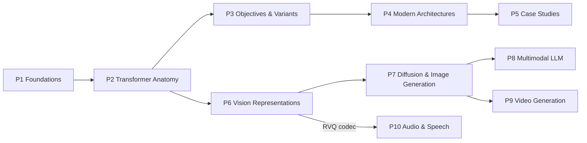

# models 维度：目录、依赖图与进度表

models 维度讲生成式模型的数学：文本 LLM 主干、视觉表征、扩散生图、多模态 LLM、视频生成、语音音频，共 10 个 Part / 51 章。写法为公式级：关键公式完整推导不跳步、逐公式附符号表、与官方实现代码对照；数值事实（参数量 / config 字段 / benchmark 数字）全部带出处并标注证据等级 [A]/[B]/[C]/[W]（定义见 [STYLE_GUIDE.md](../STYLE_GUIDE.md)）。训练算法、serving 系统、GPU kernel、集群通信分别归 `training/`、`inference/`、`gpu/`、`cluster/` 四个兄弟维度，交叉处只链接不展开。

本文件是全维度唯一进度事实源：逐章状态见下方进度表，各波 evaluator 审查结论追加在文末审查记录区。章节大纲与波次划分的唯一设计事实源是 [spec](../docs/superpowers/specs/2026-11-09-models-dimension-design.md)；文献索引与术语表见 [references.md](references.md)。

## 前置知识

- 线性代数：矩阵乘法与 rank、内积与投影、特征分解；张量 shape 全书统一 `[B, T, H, D]` 记法
- 概率论：条件分布与边缘化、期望、KL 散度、高斯分布、Bayes 规则；7.3 / 7.5 另需 ODE 直觉
- Python / PyTorch：能读官方 modeling 代码——代码走读锚点是 transformers、flash-attention、diffusers 等 repo 的具体文件与函数

章节自包含：每个公式附符号表；跨章前置概念给链接，不重复展开。

## 目录

### Part 1 · Foundations（`01-foundations/`，3 章，W1）

- 1.1 [语言建模的数学形式化](01-foundations/01-formulation.md)：样本空间 = token 序列、AR 分解推导、cross-entropy ↔ KL、perplexity 的陷阱
- 1.2 [参数、计算、内存的账](01-foundations/02-compute-accounting.md)：matmul FLOPs、C≈6ND 完整推导、参数 / 激活 / KV cache / 优化器态四笔内存账
- 1.3 [Scaling Laws（作为理论）](01-foundations/03-scaling-laws.md)：Kaplan 与 Chinchilla 幂律、compute-optimal 分配的 Lagrangian 推导、emergence 的测量学解释

### Part 2 · Transformer Anatomy（`02-transformer-anatomy/`，8 章，W1）

- 2.1 [架构总览与设计约束](02-transformer-anatomy/01-overview.md)：residual stream 形式化、12Ld² 参数账、每层计算量 / 顺序操作 / 路径长度三指标
- 2.2 [Tokenization 与 Embedding](02-transformer-anatomy/02-tokenization-and-embeddings.md)：BPE / Unigram 算法、vocab size 三方权衡、weight tying 梯度耦合
- 2.3 [Attention 机制解剖](02-transformer-anatomy/03-attention-mechanism.md)：√d_k 方差推导、softmax Jacobian 与饱和、permutation equivariance 证明
- 2.4 [Causality 与 KV Cache](02-transformer-anatomy/04-causality-and-kv-cache.md)：mask 数学、KV 可缓存性推导、cache size 公式、prefill / decode 算术强度
- 2.5 [位置编码全谱系](02-transformer-anatomy/05-positional-encoding.md)：sinusoidal 相对位移、ALiBi、RoPE 内积不变性完整证明、外推失败模式
- 2.6 [FFN 与非线性](02-transformer-anatomy/06-ffn.md)：GELU / SwiGLU、三矩阵参数等价推导、FFN-as-key-value-memory 分解
- 2.7 [Normalization 与 Residual](02-transformer-anatomy/07-norm-and-residual.md)：RMSNorm、Pre-LN vs Post-LN 梯度分析、QK-Norm、residual 梯度流
- 2.8 [组装完整 Decoder Block](02-transformer-anatomy/08-assembly.md)：config.json ↔ 公式映射表、~150 行 minimal PyTorch、modeling_llama.py 走读

### Part 3 · Objectives & Variants（`03-objectives-and-variants/`，3 章，W2）

- 3.1 [Objective 与 Mask 的统一形式化](03-objectives-and-variants/01-objectives-and-masks.md)：CLM / MLM / prefix-LM / span corruption / UL2 统一为 attention mask + loss mask + corruption 方案
- 3.2 [Encoder-only 与 Encoder-Decoder](03-objectives-and-variants/02-encoder-architectures.md)：无法自回归生成的证明、ELECTRA RTD 目标、cross-attention 依赖结构
- 3.3 [Decoder-only 与 In-Context Learning](03-objectives-and-variants/03-decoder-only-and-icl.md)：AR 通用接口三条机制论证、ICL 三层理论（隐式 GD / induction heads / 任务识别）

### Part 4 · Modern Architectures（`04-modern-architectures/`，8 章，W2）

- 4.1 [KV 压缩与精确 Attention 加速](04-modern-architectures/01-kv-compression-and-exact-attention.md)：MQA / GQA / MLA 推导、W_UK absorption、FlashAttention online softmax 正确性
- 4.2 [Sparse Attention](04-modern-architectures/02-sparse-attention.md)：SWA 感受野、attention sinks、NSA 三分支、DSA lightning indexer、MoBA 块路由
- 4.3 [Linear Attention 与 State-Space Models](04-modern-architectures/03-linear-attention-and-ssm.md)：结合律重排、linear attention ≡ 矩阵状态 RNN、DeltaNet / GDN / KDA 状态更新、Mamba 离散化
- 4.4 [Hybrid 架构（linear + full attention 交错）](04-modern-architectures/04-hybrid-architectures.md)：交错模式对照（Qwen3-Next / Kimi Linear / Jamba）、每层固定 state vs 线性增长 KV 的内存账
- 4.5 [Mixture-of-Experts 与 MTP](04-modern-architectures/05-moe.md)：noisy top-k gating、load balancing aux loss 推导、aux-loss-free routing、MTP 目标
- 4.6 [Long Context](04-modern-architectures/06-long-context.md)：FLOPs / KV 内存 / 熵稀释 / 位置外推四堵墙、PI / NTK / YaRN 缩放族推导、RULER 评测方法论
- 4.7 [机制可解释性基础](04-modern-architectures/07-interpretability-primer.md)：logit lens、superposition、SAE、induction head circuits、activation patching
- 4.8 [前沿方向（短篇，标注成熟度）](04-modern-architectures/08-frontier-outlook.md)：diffusion LLM、test-time scaling 与 agentic 的架构含义、MoD / differential attention / TTT

### Part 5 · Case Studies（`05-case-studies/`，6 章，W3）

- 5.1 [Llama 谱系（开源参照系）](05-case-studies/01-llama-lineage.md)：Llama-1 标准配方 → Llama-4 MoE，逐代 config diff 与每个改动的技术原因
- 5.2 [DeepSeek](05-case-studies/02-deepseek.md)：V2 / V3 / V3.2 谱系、MLA 与 aux-loss-free routing、DeepSeek-V3 config.json 逐字段精读
- 5.3 [Qwen](05-case-studies/03-qwen.md)：Qwen1.5 → Qwen3-Next hybrid 谱系、150K vocab 压缩率账、layer_types 字段走读
- 5.4 [GLM](05-case-studies/04-glm.md)：blank infilling objective 谱系、GLM-4.5 / 4.6、无 paper 模型的事实核查方法论示范
- 5.5 [Kimi / Moonshot](05-case-studies/05-kimi-moonshot.md)：Moonlight upcycling、K2 MuonClip（QK-clip）、KDA / K3 谱系
- 5.6 [跨家对照与方法论](05-case-studies/06-cross-lab-comparison.md)：五家旗舰总表、收敛点机制分析、30 分钟拆解新模型的 checklist

### Part 6 · Vision Representations（`06-vision-representations/`，3 章，W3）

- 6.1 [Vision Transformer](06-vision-representations/01-vit.md)：patchify = conv ≡ linear、2D 位置编码、SigLIP sigmoid pairwise loss
- 6.2 [CLIP 与对比学习](06-vision-representations/02-clip-and-contrastive.md)：InfoNCE 双向 CE 推导、zero-shot 分类 = 检索、alignment & uniformity 指标
- 6.3 [Autoencoder 与 Visual Tokenizer](06-vision-representations/03-autoencoders-and-tokenizers.md)：VAE ELBO、VQ-VAE straight-through、RVQ 递推与 bitrate 账、LFQ、DC-AE 深压缩

### Part 7 · Diffusion & Image Generation（`07-diffusion-image-generation/`，7 章，W4）

- 7.1 [生成模型家族统一对照](07-diffusion-image-generation/01-generative-model-map.md)：AR / VAE / GAN / Flow / Diffusion 的似然 / 采样步数 / mode 行为总表
- 7.2 [DDPM 完整推导](07-diffusion-image-generation/02-ddpm.md)：前向闭式解、后验 q(x_{t−1}|x_t,x_0) 配方、ELBO → L_simple
- 7.3 [Score-Based 视角与 SDE/ODE](07-diffusion-image-generation/03-score-sde.md)：denoising score matching 等价性（Vincent 定理）、probability-flow ODE
- 7.4 [采样器与 Guidance](07-diffusion-image-generation/04-sampling-and-guidance.md)：DDIM、CFG 完整推导、DPM-Solver、consistency / DMD 蒸馏族
- 7.5 [Flow Matching](07-diffusion-image-generation/05-flow-matching.md)：conditional FM 定理、rectified flow 线性路径、FM ↔ diffusion 参数化映射
- 7.6 [Latent Diffusion、DiT 与 MMDiT](07-diffusion-image-generation/06-latent-diffusion-and-dit.md)：latent token 账、adaLN-Zero、MMDiT 联合 attention 矩阵
- 7.7 [T2I 系统拆解与 AR 生图](07-diffusion-image-generation/07-t2i-systems-and-ar-image.md)：SD3 / SDXL / Imagen、LlamaGen / VAR / Infinity、MaskGIT、Emu3 全 token 统一

### Part 8 · Multimodal LLMs（`08-multimodal-llm/`，5 章，W5）

- 8.1 [VLM 架构分类学](08-multimodal-llm/01-vlm-architecture-taxonomy.md)：input-level / cross-attention / 混合三个接入点公式、visual token 预算账
- 8.2 [Connector 与分辨率处理](08-multimodal-llm/02-connectors-and-resolution.md)：MLP / Q-Former / Perceiver resampler、pixel shuffle、AnyRes tiling、M-RoPE 三元组
- 8.3 [VLM 训练目标与数据形式](08-multimodal-llm/03-training-objectives.md)：loss masking、多阶段配方、幻觉的形式化与缓解、评测方法论
- 8.4 [视频理解](08-multimodal-llm/04-video-understanding.md)：帧数 × token 预算、dynamic FPS 与绝对时间编码、时间压缩、temporal grounding
- 8.5 [统一理解与生成](08-multimodal-llm/05-unified-understanding-generation.md)：离散 token（Emu3 / Chameleon / Janus）vs 连续 latent（Transfusion）vs diffusion head

### Part 9 · Video Generation（`09-video-generation/`，4 章，W6）

- 9.1 [Video VAE](09-video-generation/01-video-vae.md)：3D causal conv 结构、时空压缩率预算、720p×5s 全链路内存账
- 9.2 [时空 DiT](09-video-generation/02-spatiotemporal-dit.md)：full 3D vs factorized attention 的 FLOPs 账、CogVideoX / HunyuanVideo / Wan 走读、Wan2.2 SNR-split MoE
- 9.3 [训练配方与加速/流式生成](09-video-generation/03-training-and-acceleration.md)：CausVid 非对称蒸馏、Diffusion Forcing、Self-Forcing、长视频三路线
- 9.4 [控制与编辑](09-video-generation/04-control-and-editing.md)：I2V 条件注入、ControlNet-for-DiT zero-conv、Plücker 相机控制、DDIM inversion 视频编辑

### Part 10 · Audio & Speech（`10-audio-speech/`，4 章，W7）

- 10.1 [音频表征：特征与 Neural Codec](10-audio-speech/01-audio-representations.md)：STFT / mel 公式、semantic vs acoustic tokens、RVQ bitrate 账、Mimi split-RVQ
- 10.2 [语音识别](10-audio-speech/02-asr.md)：CTC 边缘化与 forward-backward 推导、RNN-T lattice、Whisper 走读
- 10.3 [语音合成](10-audio-speech/03-tts.md)：HiFi-GAN / BigVGAN vocoder、VITS、VALL-E 两阶段、CosyVoice / F5-TTS 的 FM 路线
- 10.4 [Speech LLM 与全双工](10-audio-speech/04-speech-llm-and-duplex.md)：Thinker-Talker、Moshi multi-stream 与 RQ-Transformer、full-duplex 延迟账

## Part 依赖图

主干 P1→P2→P3→P4→P5 是文本 LLM 线，按序读——P2 各章是后续一切的公共前置（attention、KV cache、RoPE、RMSNorm 的推导只在那里写一遍）。支线从 P2 分出：P6 讲图像如何变成 latent / token，P7 在其上建扩散数学，P8 复用 P6 的 ViT / CLIP 与 P7 的扩散目标，P9 把 P7 的 DiT 扩到时空维，P10 直接复用 P6.3 的 RVQ 公式建音频 codec。

## 进度表

状态取值与流转：未开始 → 已写（write pass 完成）→ 审查中（evaluator 对抗审查与修复进行中）→ 已关闭（S1/S2 findings 全部修复、复审通过）。更新规则：每章状态变化即改对应行，随同该波 commit 提交（spec §6.4 / §6.5）；其他文件不重复维护进度。

### Part 1 · Foundations（W1）

| 章节 | 文件 | 状态 |
| --- | --- | --- |
| 1.1 语言建模的数学形式化 | [01-formulation.md](01-foundations/01-formulation.md) | 已写 |
| 1.2 参数、计算、内存的账 | [02-compute-accounting.md](01-foundations/02-compute-accounting.md) | 已写 |
| 1.3 Scaling Laws（作为理论） | [03-scaling-laws.md](01-foundations/03-scaling-laws.md) | 已写 |

### Part 2 · Transformer Anatomy（W1）

| 章节 | 文件 | 状态 |
| --- | --- | --- |
| 2.1 架构总览与设计约束 | [01-overview.md](02-transformer-anatomy/01-overview.md) | 已写 |
| 2.2 Tokenization 与 Embedding | [02-tokenization-and-embeddings.md](02-transformer-anatomy/02-tokenization-and-embeddings.md) | 已写 |
| 2.3 Attention 机制解剖 | [03-attention-mechanism.md](02-transformer-anatomy/03-attention-mechanism.md) | 未开始 |
| 2.4 Causality 与 KV Cache | [04-causality-and-kv-cache.md](02-transformer-anatomy/04-causality-and-kv-cache.md) | 未开始 |
| 2.5 位置编码全谱系 | [05-positional-encoding.md](02-transformer-anatomy/05-positional-encoding.md) | 未开始 |
| 2.6 FFN 与非线性 | [06-ffn.md](02-transformer-anatomy/06-ffn.md) | 未开始 |
| 2.7 Normalization 与 Residual | [07-norm-and-residual.md](02-transformer-anatomy/07-norm-and-residual.md) | 未开始 |
| 2.8 组装完整 Decoder Block | [08-assembly.md](02-transformer-anatomy/08-assembly.md) | 未开始 |

### Part 3 · Objectives & Variants（W2）

| 章节 | 文件 | 状态 |
| --- | --- | --- |
| 3.1 Objective 与 Mask 的统一形式化 | [01-objectives-and-masks.md](03-objectives-and-variants/01-objectives-and-masks.md) | 未开始 |
| 3.2 Encoder-only 与 Encoder-Decoder | [02-encoder-architectures.md](03-objectives-and-variants/02-encoder-architectures.md) | 未开始 |
| 3.3 Decoder-only 与 In-Context Learning | [03-decoder-only-and-icl.md](03-objectives-and-variants/03-decoder-only-and-icl.md) | 未开始 |

### Part 4 · Modern Architectures（W2）

| 章节 | 文件 | 状态 |
| --- | --- | --- |
| 4.1 KV 压缩与精确 Attention 加速 | [01-kv-compression-and-exact-attention.md](04-modern-architectures/01-kv-compression-and-exact-attention.md) | 未开始 |
| 4.2 Sparse Attention | [02-sparse-attention.md](04-modern-architectures/02-sparse-attention.md) | 未开始 |
| 4.3 Linear Attention 与 State-Space Models | [03-linear-attention-and-ssm.md](04-modern-architectures/03-linear-attention-and-ssm.md) | 未开始 |
| 4.4 Hybrid 架构（linear + full attention 交错） | [04-hybrid-architectures.md](04-modern-architectures/04-hybrid-architectures.md) | 未开始 |
| 4.5 Mixture-of-Experts 与 MTP | [05-moe.md](04-modern-architectures/05-moe.md) | 未开始 |
| 4.6 Long Context | [06-long-context.md](04-modern-architectures/06-long-context.md) | 未开始 |
| 4.7 机制可解释性基础 | [07-interpretability-primer.md](04-modern-architectures/07-interpretability-primer.md) | 未开始 |
| 4.8 前沿方向（短篇，标注成熟度） | [08-frontier-outlook.md](04-modern-architectures/08-frontier-outlook.md) | 未开始 |

### Part 5 · Case Studies（W3）

| 章节 | 文件 | 状态 |
| --- | --- | --- |
| 5.1 Llama 谱系（开源参照系） | [01-llama-lineage.md](05-case-studies/01-llama-lineage.md) | 未开始 |
| 5.2 DeepSeek | [02-deepseek.md](05-case-studies/02-deepseek.md) | 未开始 |
| 5.3 Qwen | [03-qwen.md](05-case-studies/03-qwen.md) | 未开始 |
| 5.4 GLM | [04-glm.md](05-case-studies/04-glm.md) | 未开始 |
| 5.5 Kimi / Moonshot | [05-kimi-moonshot.md](05-case-studies/05-kimi-moonshot.md) | 未开始 |
| 5.6 跨家对照与方法论 | [06-cross-lab-comparison.md](05-case-studies/06-cross-lab-comparison.md) | 未开始 |

### Part 6 · Vision Representations（W3）

| 章节 | 文件 | 状态 |
| --- | --- | --- |
| 6.1 Vision Transformer | [01-vit.md](06-vision-representations/01-vit.md) | 未开始 |
| 6.2 CLIP 与对比学习 | [02-clip-and-contrastive.md](06-vision-representations/02-clip-and-contrastive.md) | 未开始 |
| 6.3 Autoencoder 与 Visual Tokenizer | [03-autoencoders-and-tokenizers.md](06-vision-representations/03-autoencoders-and-tokenizers.md) | 未开始 |

### Part 7 · Diffusion & Image Generation（W4）

| 章节 | 文件 | 状态 |
| --- | --- | --- |
| 7.1 生成模型家族统一对照 | [01-generative-model-map.md](07-diffusion-image-generation/01-generative-model-map.md) | 未开始 |
| 7.2 DDPM 完整推导 | [02-ddpm.md](07-diffusion-image-generation/02-ddpm.md) | 未开始 |
| 7.3 Score-Based 视角与 SDE/ODE | [03-score-sde.md](07-diffusion-image-generation/03-score-sde.md) | 未开始 |
| 7.4 采样器与 Guidance | [04-sampling-and-guidance.md](07-diffusion-image-generation/04-sampling-and-guidance.md) | 未开始 |
| 7.5 Flow Matching | [05-flow-matching.md](07-diffusion-image-generation/05-flow-matching.md) | 未开始 |
| 7.6 Latent Diffusion、DiT 与 MMDiT | [06-latent-diffusion-and-dit.md](07-diffusion-image-generation/06-latent-diffusion-and-dit.md) | 未开始 |
| 7.7 T2I 系统拆解与 AR 生图 | [07-t2i-systems-and-ar-image.md](07-diffusion-image-generation/07-t2i-systems-and-ar-image.md) | 未开始 |

### Part 8 · Multimodal LLMs（W5）

| 章节 | 文件 | 状态 |
| --- | --- | --- |
| 8.1 VLM 架构分类学 | [01-vlm-architecture-taxonomy.md](08-multimodal-llm/01-vlm-architecture-taxonomy.md) | 未开始 |
| 8.2 Connector 与分辨率处理 | [02-connectors-and-resolution.md](08-multimodal-llm/02-connectors-and-resolution.md) | 未开始 |
| 8.3 VLM 训练目标与数据形式 | [03-training-objectives.md](08-multimodal-llm/03-training-objectives.md) | 未开始 |
| 8.4 视频理解 | [04-video-understanding.md](08-multimodal-llm/04-video-understanding.md) | 未开始 |
| 8.5 统一理解与生成 | [05-unified-understanding-generation.md](08-multimodal-llm/05-unified-understanding-generation.md) | 未开始 |

### Part 9 · Video Generation（W6）

| 章节 | 文件 | 状态 |
| --- | --- | --- |
| 9.1 Video VAE | [01-video-vae.md](09-video-generation/01-video-vae.md) | 未开始 |
| 9.2 时空 DiT | [02-spatiotemporal-dit.md](09-video-generation/02-spatiotemporal-dit.md) | 未开始 |
| 9.3 训练配方与加速/流式生成 | [03-training-and-acceleration.md](09-video-generation/03-training-and-acceleration.md) | 未开始 |
| 9.4 控制与编辑 | [04-control-and-editing.md](09-video-generation/04-control-and-editing.md) | 未开始 |

### Part 10 · Audio & Speech（W7）

| 章节 | 文件 | 状态 |
| --- | --- | --- |
| 10.1 音频表征：特征与 Neural Codec | [01-audio-representations.md](10-audio-speech/01-audio-representations.md) | 未开始 |
| 10.2 语音识别 | [02-asr.md](10-audio-speech/02-asr.md) | 未开始 |
| 10.3 语音合成 | [03-tts.md](10-audio-speech/03-tts.md) | 未开始 |
| 10.4 Speech LLM 与全双工 | [04-speech-llm-and-duplex.md](10-audio-speech/04-speech-llm-and-duplex.md) | 未开始 |

## 审查记录

各波 evaluator 对抗审查的结论追加在此处（流程、severity 分级与 verification log 要求见 spec §6.3）。此处只记汇总；完整 findings 表与 verification log 存各波审查档案。

| 波次 | 日期 | 覆盖章节 | 审查轮次 | S1 | S2 | S3 | 未关闭项 | 结论 |
| --- | --- | --- | --- | --- | --- | --- | --- | --- |

（暂无）
