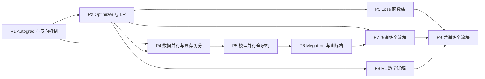

# training 维度：目录、依赖图与进度表

training 维度讲训练动力学与训练系统：autograd 与反向机制、optimizer 与 LR 动力学、loss 函数族、数据并行（DDP / ZeRO / FSDP）与模型并行（TP / SP / CP / PP / EP）、Megatron-LM 系统实现、预训练全流程、RL 数学、后训练全流程，共 9 个 Part / 39 章。写法与 models 维度同规：公式级推导不跳步、逐公式附符号表、与官方实现代码对照；数值事实（通信量 / 显存账 / 配方字段 / 报告数字）全部带出处并标注证据等级 [A]/[B]/[C]/[W]（定义见 [STYLE_GUIDE.md](../STYLE_GUIDE.md)；training 对方法/框架锚点的口径细化见 spec §4.1）。模型结构与训练目标的数学形式归 `models/`，serving 归 `inference/`，kernel 归 `gpu/`，网络与拓扑归 `cluster/`，交叉处只做纯文字指引、不重复展开（规则见 spec §2/§4.2）。

本文件是全维度唯一进度事实源：逐章状态见下方进度表，各波 evaluator 审查结论追加在文末审查记录区。章节大纲与波次划分的唯一设计事实源是 [spec](../docs/superpowers/specs/2026-11-16-training-dimension-design.md)；文献索引与术语表见 [references.md](references.md)。

## 前置知识

- **models 维度 Part 1-2**：语言建模形式化（1.1）、参数/计算/内存的账（1.2）、Transformer 各组件推导（2.1-2.8：attention、KV cache、RoPE、RMSNorm、SwiGLU）——或同等知识；跨章引用一律纯文字（如「models 2.3 §3.4」）
- 线性代数与概率论：同 models 维度；P8 另需 MDP 直觉（章内建立）
- Python / PyTorch：能读训练栈源码——代码走读锚点是 pytorch、Megatron-LM、DeepSpeed、TRL、veRL 等 repo 的具体文件与函数

章节自包含：每个公式附符号表；跨章前置概念给纯文字指引，不重复展开。

锚定纪律：官方实现引用一律到 repo + 文件 + 函数级并记录核实日期；库内部类名/路径随版本漂移时，正文标注核实时的版本（如「此类名核实于 PyTorch ≤ 2.10」）。

## 目录

### Part 1 · Autograd 与反向机制（`01-autograd-and-backprop/`，5 章，W1）

- 1.1 计算图与 autograd 的执行机制：vjp 链式执行、前向/反向模式账、PyTorch autograd 机制走读（`01-computation-graph-and-autograd.md`）
- 1.2 训练算子的反向推导：matmul / norm / softmax-CE 融合反向、FlashAttention 反向重算、fused CE（`02-operator-backward.md`）【重】
- 1.3 混合精度与 FP8：fp16/bf16/FP8 格式账、loss scaling 推导、DeepSeek-V3 FP8 方案全拆（`03-mixed-precision.md`）
- 1.4 激活内存与 Gradient Checkpointing：√L 分段最优、selective recompute、torch.utils.checkpoint 机制（`04-gradient-checkpointing.md`）
- 1.5 Gradient Accumulation 与 Micro-batch：累加等价性、与 LR/DDP no_sync 的耦合（`05-gradient-accumulation.md`）

### Part 2 · Optimizer 与 LR 动力学（`02-optimizers/`，5 章，W1）

- 2.1 SGD 与 Momentum 完整推导：噪声视角、momentum 两形式等价、二次碗速率（`01-sgd-and-momentum.md`）
- 2.2 Adam → AdamW 完整推导：bias correction、L2 ≠ weight decay 解耦证明、LLM 超参惯例（`02-adam-and-adamw.md`）【重】
- 2.3 LR Schedule、Warmup 与 Batch 联动：WSD、linear/sqrt scaling rule、critical batch size（`03-lr-schedules.md`）
- 2.4 梯度裁剪与稳定性原语：global norm clipping、稳定原语 placement 总图（`04-gradient-clipping-and-stability.md`）
- 2.5 Muon 与谱方法：谱约束最速下降 = msign、Newton-Schulz 迭代、MuonClip、效率账（`05-muon-and-spectral.md`）【重】

### Part 3 · Loss 函数族（`03-loss-functions/`，2 章，W2）

- 3.1 CE 家族与数值稳定实现：logsumexp、fused CE 的账、label smoothing、z-loss 对照（`01-ce-family.md`）
- 3.2 偏好与对比目标的接口：Bradley-Terry、reward 平移不可识别、在线/离线分界定义（`02-preference-and-contrastive-objectives.md`）

### Part 4 · 数据并行与显存切分（`04-data-parallelism/`，4 章，W2）

- 4.1 DP → DDP：数据并行的数学与实现、ring all-reduce 通信账、bucket 化与 overlap（`01-dp-and-ddp.md`）
- 4.2 ZeRO：优化器状态、梯度、参数的逐阶切分：各阶通信量推导、ZeRO-3 取回时序、DeepSpeed 走读（`02-zero.md`）【重】
- 4.3 FSDP / FSDP2：PyTorch 原生的全分片：分片语义、峰值显存公式、FSDP2 DTensor（`03-fsdp.md`）
- 4.4 显存与通信的统一账：单卡显存总账、真实数字表、MFU 口径、DP/ZeRO/FSDP 家族决策树（`04-memory-and-comms-accounting.md`）

### Part 5 · 模型并行全家桶（`05-model-parallelism/`，5 章，W3）

- 5.1 TP：列切、行切与 all-reduce 位置：f/g 恒等算子推导、每层通信账（`01-tensor-parallelism.md`）【重】
- 5.2 SP / CP：序列维的切分：SP 通信恒等、Ring Attention、striped 均衡、Ulysses（`02-sequence-and-context-parallelism.md`）
- 5.3 PP：流水线气泡与 Schedule：气泡公式、1F1B、interleaved、zero-bubble、DualPipe（`03-pipeline-parallelism.md`）【重】
- 5.4 EP：专家并行与 All-to-All：dispatch/combine、通信账、负载不均衡的系统形态（`04-expert-parallelism.md`）
- 5.5 组合策略与总账：拓扑-带宽匹配、GPU 数乘积、真实配置走读对照（`05-combining-strategies.md`）

### Part 6 · Megatron-LM 与现代训练栈（`06-megatron-and-stacks/`，3 章，W3）

- 6.1 Megatron 的层栈并行原语：ColumnParallel/RowParallel/VocabParallel 走读、f/g 的 autograd 实现（`01-megatron-architecture.md`）
- 6.2 Megatron 运行时：进程组、调度与 Distributed Optimizer：parallel_state 走读、与 ZeRO 对照（`02-megatron-runtime.md`）
- 6.3 现代训练栈对照与选型（短篇）：Megatron-Core / NeMo / TorchTitan / DeepSpeed / 后训练栈（`03-modern-training-stacks.md`）

### Part 7 · 预训练全流程（`07-pretraining/`，5 章，W4）

- 7.1 数据管线与配比：过滤/去重/配比/packing、FineWeb 与 DCLM 方法学（`01-data-pipeline.md`）
- 7.2 预训练配方：lr / bsz / warmup / decay / µP：真实配方全字段对照表、µP 缩放规则（`02-recipes.md`）【重】
- 7.3 训练稳定性：Loss Spike、监控与干预：机制分类学、指标体系、干预手册、各家记录（`03-training-stability.md`）
- 7.4 Checkpoint 与续训：完整可恢复性、分布式 checkpoint、异步写盘、MTBF 账（`04-checkpointing-and-resumption.md`）
- 7.5 长上下文扩展与中后期训练（短篇）：mid-training 概念、training 侧成本账（`05-long-context-and-mid-training.md`）

### Part 8 · RL 数学详解（`08-rl-math/`，5 章，W5）

- 8.1 MDP、策略梯度定理与 REINFORCE：PG 定理完整推导、baseline 无偏性（`01-policy-gradient.md`）【重】
- 8.2 Actor-Critic 与 GAE：TD 残差、λ-return 组合、LLM 场景退化形态（`02-actor-critic-and-gae.md`）
- 8.3 PPO 完整推导：clip 目标、完整算法、实现细节清单（`03-ppo.md`）【重】
- 8.4 GRPO 与 LLM-RL 变体：组基线推导、k3 KL 估计、Dr.GRPO / DAPO / GSPO（`04-grpo-and-variants.md`）【重】
- 8.5 LLM-RL 的系统实现：四模型显存账、rollout/train 引擎拆分、权重同步、veRL/OpenRLHF 走读（`05-llm-rl-systems.md`）

### Part 9 · 后训练全流程（`09-post-training/`，5 章，W6）

- 9.1 SFT：指令微调的流程与数据形态：chat template、多轮 masking、配方与 forgetting（`01-sft.md`）
- 9.2 RLHF 全链：Reward Model → PPO：BT 目标、reward hacking、四模型全链路（`02-rlhf-pipeline.md`）【重】
- 9.3 DPO 家族：直接偏好优化：DPO 闭式解全链、IPO / KTO / SimPO / ORPO（`03-dpo-family.md`）【重】
- 9.4 RFT 与拒绝采样：截断采样形式化、self-improvement 循环、在线/离线判据表（`04-rejection-sampling-and-rft.md`）
- 9.5 RLVR 与推理模型的训练：可验证奖励、DeepSeek-R1 全链拆解、长 CoT 动力学（`05-rlvr-and-reasoning.md`）

## Part 依赖图

优化线 P1→P2→P3、并行线 P4→P5→P6、合流于 P7；P8 立于 P2 与 models 1.1 之上、与 P3 一同汇入 P9。两处章级前瞻引用（先于定义章使用、以回链闭合）：1.5 用 DDP `no_sync` 的 API 语义（4.1 正式走读 DDP 机制，回链 1.5）；4.4 引用 P5 的 TP/PP 激活切分公式（标注「P5 预告」，5.5 收总账）。

## 与 models 的接口

models 侧交叉链接到这里的章节（training 上线后这些指针生效）：

- [1.2 参数、计算、内存的账](../models/01-foundations/02-compute-accounting.md)：优化器状态内存账（式 (8)）
- P5 案例章训练侧：[5.2 DeepSeek](../models/05-case-studies/02-deepseek.md)（FP8 训练工程 → 本维度 1.3）、[5.3 Qwen](../models/05-case-studies/03-qwen.md)（thinking 模式 → 9.5）、[5.5 Kimi / Moonshot](../models/05-case-studies/05-kimi-moonshot.md)（Muon → 2.5、K1.5 RL → 9.5）
- [4.5 MoE](../models/04-modern-architectures/05-moe.md) §7：EP 训练侧主题 → 本维度 5.3 / 5.4（2026-11-16 errata 修订，见审查记录）

## 进度表

状态取值与流转：未开始 → 已写（write pass 完成）→ 审查中（evaluator 对抗审查与修复进行中）→ 已关闭（S1/S2 findings 全部修复、复审通过）。更新规则：每章状态变化即改对应行，随同该波 commit 提交（spec §6.4 / §6.5）；其他文件不重复维护进度。

### Part 1 · Autograd 与反向机制（W1）

| 章节 | 文件 | 状态 |
| --- | --- | --- |
| 1.1 计算图与 autograd 的执行机制 | 01-computation-graph-and-autograd.md | 已关闭 |
| 1.2 训练算子的反向推导 | 02-operator-backward.md | 已关闭 |
| 1.3 混合精度与 FP8 | 03-mixed-precision.md | 已关闭 |
| 1.4 激活内存与 Gradient Checkpointing | 04-gradient-checkpointing.md | 已关闭 |
| 1.5 Gradient Accumulation 与 Micro-batch | 05-gradient-accumulation.md | 已关闭 |

### Part 2 · Optimizer 与 LR 动力学（W1）

| 章节 | 文件 | 状态 |
| --- | --- | --- |
| 2.1 SGD 与 Momentum 完整推导 | 01-sgd-and-momentum.md | 已关闭 |
| 2.2 Adam → AdamW 完整推导 | 02-adam-and-adamw.md | 已关闭 |
| 2.3 LR Schedule、Warmup 与 Batch 联动 | 03-lr-schedules.md | 已关闭 |
| 2.4 梯度裁剪与稳定性原语 | 04-gradient-clipping-and-stability.md | 已关闭 |
| 2.5 Muon 与谱方法 | 05-muon-and-spectral.md | 已关闭 |

### Part 3 · Loss 函数族（W2）

| 章节 | 文件 | 状态 |
| --- | --- | --- |
| 3.1 CE 家族与数值稳定实现 | 01-ce-family.md | 已关闭 |
| 3.2 偏好与对比目标的接口 | 02-preference-and-contrastive-objectives.md | 已关闭 |

### Part 4 · 数据并行与显存切分（W2）

| 章节 | 文件 | 状态 |
| --- | --- | --- |
| 4.1 DP → DDP：数据并行的数学与实现 | 01-dp-and-ddp.md | 已关闭 |
| 4.2 ZeRO：优化器状态、梯度、参数的逐阶切分 | 02-zero.md | 已关闭 |
| 4.3 FSDP / FSDP2：PyTorch 原生的全分片 | 03-fsdp.md | 已关闭 |
| 4.4 显存与通信的统一账 | 04-memory-and-comms-accounting.md | 已关闭 |

### Part 5 · 模型并行全家桶（W3）

| 章节 | 文件 | 状态 |
| --- | --- | --- |
| 5.1 TP：列切、行切与 all-reduce 位置 | 01-tensor-parallelism.md | 已关闭 |
| 5.2 SP / CP：序列维的切分 | 02-sequence-and-context-parallelism.md | 已关闭 |
| 5.3 PP：流水线气泡与 Schedule | 03-pipeline-parallelism.md | 已关闭 |
| 5.4 EP：专家并行与 All-to-All | 04-expert-parallelism.md | 已关闭 |
| 5.5 组合策略与总账 | 05-combining-strategies.md | 已关闭 |

### Part 6 · Megatron-LM 与现代训练栈（W3）

| 章节 | 文件 | 状态 |
| --- | --- | --- |
| 6.1 Megatron 的层栈并行原语 | 01-megatron-architecture.md | 已关闭 |
| 6.2 Megatron 运行时：进程组、调度与 Distributed Optimizer | 02-megatron-runtime.md | 已关闭 |
| 6.3 现代训练栈对照与选型（短篇） | 03-modern-training-stacks.md | 已关闭 |

### Part 7 · 预训练全流程（W4）

| 章节 | 文件 | 状态 |
| --- | --- | --- |
| 7.1 数据管线与配比 | 01-data-pipeline.md | 已关闭 |
| 7.2 预训练配方：lr / bsz / warmup / decay / µP | 02-recipes.md | 已关闭 |
| 7.3 训练稳定性：Loss Spike、监控与干预 | 03-training-stability.md | 已关闭 |
| 7.4 Checkpoint 与续训 | 04-checkpointing-and-resumption.md | 已关闭 |
| 7.5 长上下文扩展与中后期训练（短篇） | 05-long-context-and-mid-training.md | 已关闭 |

### Part 8 · RL 数学详解（W5）

| 章节 | 文件 | 状态 |
| --- | --- | --- |
| 8.1 MDP、策略梯度定理与 REINFORCE | 01-policy-gradient.md | 已关闭 |
| 8.2 Actor-Critic 与 GAE | 02-actor-critic-and-gae.md | 已关闭 |
| 8.3 PPO 完整推导 | 03-ppo.md | 已关闭 |
| 8.4 GRPO 与 LLM-RL 变体 | 04-grpo-and-variants.md | 已关闭 |
| 8.5 LLM-RL 的系统实现 | 05-llm-rl-systems.md | 已关闭 |

### Part 9 · 后训练全流程（W6）

| 章节 | 文件 | 状态 |
| --- | --- | --- |
| 9.1 SFT：指令微调的流程与数据形态 | 01-sft.md | 已关闭 |
| 9.2 RLHF 全链：Reward Model → PPO | 02-rlhf-pipeline.md | 已关闭 |
| 9.3 DPO 家族：直接偏好优化 | 03-dpo-family.md | 已关闭 |
| 9.4 RFT 与拒绝采样 | 04-rejection-sampling-and-rft.md | 已关闭 |
| 9.5 RLVR 与推理模型的训练 | 05-rlvr-and-reasoning.md | 已关闭 |

## 审查记录

各波 evaluator 对抗审查的结论追加在此处（流程、severity 分级与 verification log 要求见 spec §6.3）。此处只记汇总；完整 findings 表与 verification log 存各波审查档案（`docs/reviews/`）。

| 波次 | 日期 | 覆盖章节 | 审查轮次 | S1 | S2 | S3 | 未关闭项 | 结论 |
| --- | --- | --- | --- | --- | --- | --- | --- | --- |
| W0 | 2026-11-16 | spec 本身（9 Part / 39 章大纲）+ 脚手架 | builder-check ×1（6 findings 全修）+ 四路独立对抗审查 ×1（A: P1-P3 事实与数学 / B: P4-P6 与站点 lint / C: P7-P9 事实与数学 / D: 设计与一致性） | 2（全部关闭：Moonlight-µTransfer 误并、K1.5 语言混杂误归 R1） | 22（全部关闭） | 20（全部清零） | 无 | 放行（四路完整档案见 [training-spec-review-a](../docs/reviews/training-spec-review-a.md) / [b](../docs/reviews/training-spec-review-b.md) / [c](../docs/reviews/training-spec-review-c.md) / [d](../docs/reviews/training-spec-review-d.md)；spec 附录有汇总）。W0 工程：lint 维度参数化 + STYLE_GUIDE 泛化 + 站点维度层（构建与 QA 全绿） |
| W1 | 2026-11-17 | P1+P2 共 10 章 | 逐章批量审查 × 3 批（批 1: P1 / 批 2: 2.1-2.3 / 批 3: 2.4-2.5+波末 sweep）+ 各批修复轮复审 × 3 | 2（全部关闭：1.4 §5 决策算例误用 GPT-3 基线 114→194 且结论翻转、2.2 §3「m̂²≤v̂ 逐坐标严格成立」伪定理——β1≠β2 时 C-S 不适用、数值反例 2.01η，双口径改写） | 13（全部关闭；含复审新引入 1 条 retain_graph 机制句） | 29（全部清零：修复 27 + 接受登记 2——1.2 §9 的 N 复用与 2.5 的 B 双用均有局部显式声明） | 无 | 暂不放行 → 修复并复审后 10 章全放行（强制重推导 9 项全 pass：1.2 matmul 反向+softmax-CE / 1.3 loss scaling / 1.4 √L / 2.1 momentum 等价+二次碗 / 2.2 bias correction+AdamW 解耦 / 2.3 linear scaling+critical batch / 2.5 msign+NS+尺度匹配；完整档案见 [training-w1-review-p1](../docs/reviews/training-w1-review-p1.md) / [p2a](../docs/reviews/training-w1-review-p2a.md) / [p2b](../docs/reviews/training-w1-review-p2b.md)）。波末收编：lint 脚本修 bash 3.2 下 `$pat`+CJK 误解析崩溃；writer 存疑项裁定 4 项（2 项成立、1 项照录正确、1 项幻影撤改）；/training/ 站点上线（80 页、QA 全绿） |
| W2 | 2026-11-17 | P3+P4 共 6 章 | 逐章批量审查 × 2 批（批 1: P3+4.1 / 批 2: 4.2-4.4+波末 sweep）+ 各批修复轮复审 × 2 | 1（全部关闭：3.1 §5「CE 梯度流恒抬 log Z」伪不等式——反例 −0.12，正确充分条件为目标位 argmax，带条件改写） | 7（全部关闭：TRL fused LM head 过时、DDP div_factor_ 张冠李戴、docstring 注记挂错分支、`\;` 禁命令、ZeRO AR 变体 3N vs 2N、4.2/4.3 跨章 ÷m 口径统一、中断统计节号 §3.3.4） | 12（全部清零：修复 10 + 接受登记 2——4.3 的 G 分片组大小有显式声明、GPU GiB 口径已声明） | 无 | 暂不放行 → 修复并复审后 6 章全放行（强制重推导 4 项全 pass：4.1 ring all-reduce / 3.1 logsumexp+z-loss 梯度 / 4.2 ZeRO 各阶通信量与取回时序 / 4.4 总账重算；完整档案见 [training-w2-review-p3](../docs/reviews/training-w2-review-p3.md) / [p4](../docs/reviews/training-w2-review-p4.md)）。波末裁定：herd Table 4 确有 Llama-3 405B 全度数与 MFU（spec 审查 B 当年判错，spec 5.5 已回改）；Offload Table 1 末行原文属实、章节处理批准 |
| W3 | 2026-11-17 | P5+P6 共 8 章 | 逐章批量审查 × 2 批（批 1: 5.1-5.3 / 批 2: 5.4-6.3+波末 sweep）+ 各批修复轮复审 × 2 | 1（全部关闭：striped-attention 的 arXiv ID 2405.13119 系宇宙学论文——spec 审查 B 当年给错 ID 沿 spec 传播，真身 2311.09431；references/spec/章节四处全线纠正，证据等级经 [B]→[A] 复核回升（官方 repo 在 exists-forall org）） | 12（全部关闭：5.4 三处口径（1/4→1/3、全程通信账、复算非对称注记）、5.5 表两行全程口径、5.2 zigzag/striped 机制分家重写、5.3 1F1B 图归属删改与级联重绘、5.3 三处节号、5.1 DGX-2H 16 卡、6.3 torchtitan 引文原文） | 15（全部清零：修复 13 + 接受登记 2） | 无 | 暂不放行 → 修复并复审后 8 章全放行（强制重推导 4 项全 pass：5.1 f/g+TP 通信账 / 5.3 气泡+1F1B / 5.4 EP all-to-all 细化 / 6.2 dist-opt↔ZeRO 对照；完整档案见 [training-w3-review-p5a](../docs/reviews/training-w3-review-p5a.md) / [p5b](../docs/reviews/training-w3-review-p5b.md)）。波末收编：models 4.5 §7 单位标签 errata 一处；NeMo 主仓重组注记 + megatron-bridge 补录；training 断言 24 章 / 6 Part、站点 98 页 QA 全绿 |
| W4 | 2026-11-17 | P7 共 5 章 | 逐章批量审查 × 2 批（批 1: 7.1-7.3 / 批 2: 7.4-7.5+波末 sweep）+ 修复轮（controller 单行复核制） | 0 | 2（全部关闭：7.2「长上下文阶段吸收缺口」与 herd Table 4 矛盾（改为 ramp 吸收 + Table 4 恒 16M 注记）、7.5 mid-training 量级带与自家锚点冲突） | 10（全部清零） | 无 | 有条件放行 → 修复后 5 章全放行（强制重推导 4 项全 pass：7.2 µP 结论表九格逐格一致 + MinHash 双源核验 / 7.4 14N 字节账 + MTBF 最优间隔 / 7.5 成本账；完整档案见 [training-w4-review-p7a](../docs/reviews/training-w4-review-p7a.md) / [p7b](../docs/reviews/training-w4-review-p7b.md)）。波末裁定：GLM-4.5「全披露」系 spec 审查 C 判错（spec 7.2 大纲已修正）；herd 58.7% vs Table 5 系原文不自洽（7.3 注记处置正确）；references 补录 qwen3 |
| W5 | 2026-11-17 | P8 共 5 章 | 逐章批量审查 × 2 批（批 1: 8.1-8.3 / 批 2: 8.4-8.5+波末 sweep）+ 各批修复轮复审 × 2 | 1（全部关闭：references verl 条目作者张冠李戴 Hu et al.→Sheng et al.——W0 时期 controller 的错，W5 批 2 抓到，传播 6 处全线纠正） | 12（全部关闭：8.4 对照表 KL 列与 DAPO/GSPO 原文矛盾、8.5 式 3 悬空与 N_a 一章两义、8.3 的 PPO 式号/Atari-MuJoCo 张冠李戴/Table 1 消融措辞/break 层级等引用定位、8.1 的 S&B 节号与最优 baseline 归属、8.2 数值对照；S2-4 一条经复审驳回——evaluator 误读缩进、原文正确） | 13（全部清零） | 无 | 暂不放行 → 修复并复审后 5 章全放行（强制重推导 5 项全 pass：8.1 PG 定理两形式+baseline / 8.2 GAE / 8.3 PPO clip 分情形 / 8.4 GRPO 组基线 (G−1)/G 偏差 + k3 KL / 8.5 四模型显存账 + 权重同步；完整档案见 [training-w5-review-p8a](../docs/reviews/training-w5-review-p8a.md) / [p8b](../docs/reviews/training-w5-review-p8b.md)）。波末收编：references 补录 greensmith2004；writer 存疑项裁定 6 项 |
| W6 | 2026-11-18 | P9 共 5 章 | 逐章批量审查 × 2 批（批 1: 9.1-9.3 / 批 2: 9.4-9.5+波末 sweep）+ 各批修复轮复审 × 2 | 1（全部关闭：9.4 式 (2) 旁注恒等式 −H 应 +H——反例 π̂=π 即假） | 9（全部关闭：9.3 练习 1(e) 题干错、9.1 TRL 分流误述与警告口径、9.2 InstructGPT 节号与 RM 精度出处、9.5 Dr.GRPO 节号、9.4 RS 质检归 model-as-judge 与过程标记删除） | 15（全部清零） | 无 | 暂不放行 → 修复并复审后 5 章全放行（强制重推导 4 项全 pass：9.2 RM 目标+Goodhart / 9.3 DPO 全链+IPO / 9.4 截断-再归一化+判据表 / 9.5 R1 四阶段逐阶段核对——含 language consistency reward 归 R1 阶段 2 确认；完整档案见 [training-w6-review-p9a](../docs/reviews/training-w6-review-p9a.md) / [p9b](../docs/reviews/training-w6-review-p9b.md)）。**training 维度 39/39 章全维度收官** |

**跨维度指针 errata 记录**（spec §2 条款授权，仅限指针句的最小修订）：

| 日期 | 位置 | 修订 |
| --- | --- | --- |
| 2026-11-16 | models/04-modern-architectures/05-moe.md §7 末句 + 总结表 EP 行 | 「全部归 cluster 维度」收窄为「训练侧归 training 5.3/5.4、硬件与拓扑归 cluster」（DualPipe / EP 切分权衡 / all-to-all 通信账的实际归属） |
| 2026-11-17 | models/04-modern-architectures/05-moe.md §7 接口量句 | 单位标签修正：「每 token 每 MoE 层 2kd 字节的通信上界」→「2kd 个元素（bf16 合 4kd 字节）」（公式 2·k·d·b 与 229 KB 数值不动；W3 审查批 2 S2-6 发现） |
